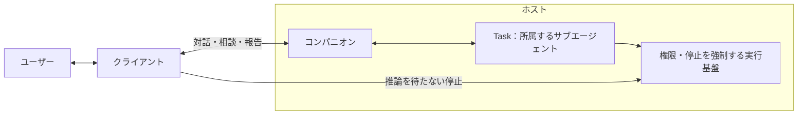

# ホストAPIの機能拡張方針

この文書は、旧API設計案に記載していたTask・相談・権限・音声などの機能構想を保持します。以下は将来機能の要件であり、現行APIでの実装を保証しません。現在提供する操作と通信型は[Connect RPC v1](connect-rpc.md)と`host.proto`を参照してください。

## 対話と作業の責務

### コンパニオンとTask

**Taskは、各コンパニオンに属し、その指示で作業する独立したLLMセッション・サブエージェントです。** [用語集](../product/terms.md)のエージェントに対応し、単なる作業記録を指すものではありません。APIで取得するTaskは、そのサブエージェントの公開状態と実行履歴です。終了後も履歴と結果を保持します。

| 主体 | 責務 |
| --- | --- |
| コンパニオン | 依頼の整理、Taskへの指示、相談の仲介、進捗説明、最終報告。Task実行中も独立して対話する |
| Task | 親コンパニオンから受けた指示と必要な文脈で作業し、進捗・質問・結果を親へ返す |
| ホスト | 両者の稼働、権限検証、停止制御、会話・状態・結果の保存、外部接続、音声合成の調整 |
| クライアント | 対話・進捗・相談の表示、入力、停止、音声再生。外観・位置・読み上げオン・オフを端末内に保持する |

[作業の依頼](../features/task/request.md)に従い、ユーザーの窓口はコンパニオンに統一します。クライアントはTaskを直接起動したり、その内部会話へ発言したりしません。相談への回答もコンパニオンのメッセージAPIから渡します。Taskの停止と権限解除は、モデルの判断や応答待ちを経由しない制御経路です。

## 拡張時の状態と対象参照

識別子はホスト内で一意な不透明な文字列です。API利用者はIDから内部実装や所在を推測せず、明示された参照を使います。

| 型 | 主な項目と意味 |
| --- | --- |
| Companion | `id`、`name`、`body`（モデル形式・所在環境・モデル参照）、`voice`（接続ID・声ID）、`mind`（口調・人格の初期設定）、`model_assignments`（`companion`・`task`それぞれの接続ID・モデルID）、`availability`、`revision` |
| Message | `id`、`companion_id`、`role`（`user` / `companion`）、`text`、`status`、`created_at`、会話内で不変の`sequence`、`resources`、任意の`in_reply_to`・`task_id`・`question_id`・`failure` |
| Task | `id`、`companion_id`、`origin`（MVPでは`{kind: "message", message_id}`）、`status`、`progress`（工程・説明）、`questions`、`report`、`failure` |
| Question | `id`、`companion_id`、`task_id`、`message_id`、`kind`（`clarification` / `permission`）、`text`、`status`（`open` / `resolved` / `cancelled`）、任意の`answer_message_id`・`resolution`・`grant_proposal`・`missing_permissions` |
| Grant | `id`、`companion_id`、`kind`（`folder` / `data_transfer`）、許可対象と範囲、`status`（`active` / `invalidated`）、無効化理由、`revision`。フォルダは`environment_id`・`root_path`・`access`（`read` / `edit`）、送信は`connection_id`・`destinations`・`data_kinds`・`purpose`を持つ |
| Connection | `id`、`kind`（`llm` / `tts`）、`adapter`、`endpoint`、`options`（アダプター固有の非秘密設定）、`credential_state`、`capabilities`、`last_check`。秘密情報の値は含めない |
| Speech | `speech_id`、`request_id`、`companion_id`、`message_id`、`state`、`format`、`sample_rate`、`channels`。音声接続内だけで有効な発話ストリーム |

日時はUTCのRFC 3339文字列で返し、表示するタイムゾーンはクライアントが扱います。Messageの状態は`queued`、`streaming`、`completed`、`failed`、`cancelled`です。受信したユーザーメッセージは保存時に`completed`になり、コンパニオンの返答は別のMessageとして生成します。`in_reply_to`は元のユーザーMessageを指し、受付済みの返答を追跡するために使います。Taskからの相談・報告は`task_id`で関連づけ、存在しないユーザー発言を作りません。`failure`は`code`・`message`・`details`を持ち、操作受付後の失敗も取得できます。

フォルダを操作する際の参照は`environment_id`、`grant_id`、許可ルート内の相対パスで表します。MVPでは所在環境はホストのPCだけです。モデルや作業ファイルの参照を受け取っても、別環境のクライアントから同じパスを開けることは保証しません。

メッセージの`resources`には、UIで選択した作業対象を`{kind: "folder_path", environment_id, grant_id, relative_path}`の配列で渡せます。許可ルート自体は`relative_path: "."`です。ホストは所属・許可・範囲逸脱を検証し、本文でいう「このフォルダ」と対象の対応をコンパニオンへ伝えます。参照を送るだけで編集や外部送信を許可したことにはならず、各操作時にも権限を検証します。未許可のフォルダは選択UIから許可登録を先に行い、自然言語だけの依頼で対象が曖昧ならコンパニオンが確認します。

## 将来拡張・検証項目

### docsの想定・UXとの対応

| 想定する体験・根拠 | MVPのAPIで守ること | 将来へ残す範囲 |
| --- | --- | --- |
| [体・声・心を設定](../features/character/create.md)し、[口調を反映して対話](../features/chat/character.md)する | 初期Companionを取得して段階的に設定できる。モデル・音声・描画の失敗を分離する | キャラクターパッケージ、感情・成長は別の状態・機能として追加 |
| [用途に応じてAIを選ぶ](../features/settings/models.md) | 接続はホスト共通、会話用・作業用モデル割当はCompanionごと。設定変更でも会話とTask履歴を保持 | 用途やアダプターを対応能力として追加し、既存用途の意味を変更しない |
| [作業中も同じ相手と話し、必要な相談だけに答える](../features/task/request.md) | 単一の対話窓口、独立したTask、明示的な相談ID、構造化した対象参照。停止は推論を待たない | 任意の方針変更・一時停止・再開はMVPでは提供せず、停止後の新規依頼へ案内 |
| [権限をまとめて確認し、いつでも変更する](../features/settings/permissions.md) | 機能単位の説明、既存許可の再利用、部分許可でも相談を保持、設定画面の変更も相談へ反映 | 新しい操作対象・送信用途にも同じ実行時検証を適用 |
| [切断しても作業を続け、結果を引き継ぐ](../features/hosting/README.md) | Taskと音声接続の寿命を分離し、相談・結果を保存する。再接続で重複実行・自動読み上げをしない | 複数端末の認証、コンパニオンの明示的な移動、端末不在時の制御 |
| [声を使えないときもテキストで対話](../features/voice/README.md)する | 読み上げは端末設定。音声失敗が対話を止めず、返答順に再生する | マイク入力、複数コンパニオンの発話調停 |
| [記憶](../features/memory/README.md)・[スケジュール](../features/autonomy/schedule.md)・[拡張機能](../features/extensions/README.md)を育てる | 履歴・初期人格・Taskの起点・権限を別の概念として保持し、内部ライブラリ型を露出しない | 専用リソースと能力を追加する。履歴保存を長期記憶、接続設定を拡張導入と扱わない |

### 将来のために維持する境界

- コンパニオンごとの会話・モデル割当・許可、Taskの所有関係、所在環境を識別します。MVPの1体・1件という制限はホストの対応能力として返し、型やパスに単一状態として埋め込みません。上限を増やす際には作業対象の競合制御を追加し、数値の変更だけで並行実行を有効にしません。
- 端末認証、Web向けのセッション認証、端末内操作の契約はConnect v1で実装しています。リモート公開時のTLSとプロキシ設定は別途必要です。接続許可と操作権限を分離し、認証方式を変えても対話・Task・発話の意味を維持します。
- 複数端末へ拡張するときは、認証主体、永続的な端末ID、接続セッション、コンパニオンのアクティブな表示先を分離します。履歴閲覧や通知購読だけで表示先を移さず、ユーザーの明示的な呼び出しで移動させます。音声接続ごとに1発話という制約だけでは画面全体の同時発話を防げないため、[既存の調停ルール](../features/hosting/README.md#複数コンパニオンの常駐と調停ルール)に従う表示先・発話の調停を追加してから有効化します。
- Taskの`origin.kind`、資料参照の`kind`、接続アダプターとその対応能力を拡張点にします。スケジュール等の起点は架空のユーザーMessageへ変換せず、実際に実装する段階で追加します。未知の種類を理解できないクライアントは閲覧可能な共通情報だけを表示し、対応する制御は行いません。新しい必須動作は能力の確認やAPIバージョンで区別します。
- Rig、SQLite、音声エンジン、描画プロセスの内部型・制御を通信型へ直接露出させません。記憶、スケジュール、拡張機能のAPIは実際に対象へ加える段階で定義します。
- `mind`は配布可能な初期人格の設定です。将来の個別記憶・成長・関係状態・資格情報は別リソースとして保持し、パッケージへの書き出しやモデル交換で混入・消去しません。外部ハーネスを追加する場合も権限・停止・結果記録の強制をホストの責務として維持します。

### 実装後の受け入れ項目

| 領域 | 検証するシナリオ・期待結果 |
| --- | --- |
| 初回設定 | 空のDBからAPIだけで接続・モデル・体・声・心・許可を設定できる。初期化途中の停止や再接続でCompanionを重複作成しない。音声・描画が未設定でもテキスト対話を開始できる |
| 所属・対話 | Taskの開始・相談・報告が親コンパニオンを通る。Task実行中も雑談でき、通常の発言を作業指示や相談回答に混入しない |
| 受付直後の停止 | 保存前・保存後202返却前・202返却後生成前・生成中でホストを停止する。保存済みなら同じキーで同じMessage IDを返し、返答がhost_interruptedになり、推論・Taskを再実行しない。保存前なら再送で初めて受け付ける |
| 再送 | 同時再送と再起動後の再送で、Message、Task起動、許可、疎通確認を重複実行しない。異なる内容のキー再利用を拒否する |
| 相談・部分許可 | 編集が必要な相談への読み取り許可、複数条件の一部だけの許可では相談がopenのままになる。残りの許可を対話・設定画面のどちらから登録しても1回だけ解決する。拒否・回答の競合、親への伝達失敗、停止との競合でも待ち状態を残さない |
| 設定・対象参照 | モデル変更でも履歴を失わず、実行中Taskへ新設定を混ぜない。複数の許可フォルダから選んだ対象が正しく渡り、別コンパニオンのGrantや無効化済みの送信許可を利用できない |
| 停止・許可 | AI応答中や音声配信中のHTTP停止・権限解除について、要求から受付応答までと実行停止までの時間を測る。受付後に新しい関連操作・送信が始まらない |
| 異常・復旧 | 外部編集、名前の衝突、保存・バックアップ失敗、成否不明の操作を完了扱いにせず、実際の変更と報告が一致し、変更前の内容・配置を手動復旧できる |
| 再接続 | スナップショット取得中の更新、欠番、遅い受信側、ホスト再起動から再同期できる。未解決の相談と報告を失わず、Taskを自動再開しない |
| 履歴・結果 | 最新ページから過去へ欠落なく遡り、50件より前の未終了Messageも同期できる。Grant解除後も結果の場所を特定でき、最終報告の生成失敗でも保存済み結果を確認できる |
| 音声の開始 | メッセージ受付から最初の実再生まで、テキスト区切り確定から最初の音声チャンクまでの時間を測る。初回と準備済み状態、短文と長文を区別する |
| 音声の連続性 | 合成と配信・再生を並行させ、途切れの回数・時間、文・句の境界の自然さ、バッファ量を測る。全文完成待ちになっていないことを確認する |
| 音声の中断 | 操作から無音になるまでの時間を測り、開始前取消、遅着音声、形式不一致、合成失敗、切断・再接続でも旧発話を再生しない |
| 認証・秘密情報 | 認証なしのHTTP・WebSocketを拒否し、秘密情報を応答・URL・ログへ露出させず、未許可の接続先へフォールバックしない |
| 互換性 | 未知の応答項目・通知・状態・種類を受けても正常な既知機能を維持し、未知の権限を許可済みと扱わない。ホスト未対応機能やクライアント未対応の制御をUIで有効化しない |

音声エンジン、アダプター、コーデック、バイナリヘッダー、チャンク長、バッファ上限、遅延の数値基準は、上記の測定と接続検証で確定します。対応能力の記載や公式APIの存在を、eneでの合成・配信・再生の動作確認と同一視しません。MVPの[機能完成条件と実利用による検証](../product/mvp.md#6-完了条件)は別に満たす必要があります。
