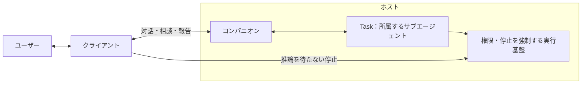

# MVPホストAPI設計案

本書は、[MVP](../product/mvp.md)と[アーキテクチャ](architecture.md)に沿って、クライアントとホストの通信契約を定めます。APIの実装、Rustの型、DBスキーマ、OpenAPI仕様を提供するものではなく、以下の動作は未検証です。

Linuxの単一PC上で、コンパニオン1体、Task同時1件、テキスト入力と音声読み上げを対象とします。設定UIまでAPIで完結させ、バックアップからの復旧は開発者がホスト上で手動で行います。マイク入力、複数端末、複数Taskの並行実行、長期記憶、スケジュール、拡張機能は今回追加しません。

`features/`は将来の完成像、本書はMVPで提供する契約です。機能を利用できるかはホストの対応能力と現在の設定・許可から判断し、将来の機能を利用できるように見せません。既存UXとの対応と拡張時の制約は[将来拡張・検証項目](#将来拡張検証項目)にまとめます。

## 目的と責務

### コンパニオンとTask

**Taskは、各コンパニオンに属し、その指示で作業する独立したLLMセッション・サブエージェントです。** [用語集](../product/terms.md)のエージェントに対応し、単なる作業記録を指すものではありません。APIで取得するTaskは、そのサブエージェントの公開状態と実行履歴です。終了後も履歴と結果を保持します。



| 主体 | 責務 |
| --- | --- |
| コンパニオン | 依頼の整理、Taskへの指示、相談の仲介、進捗説明、最終報告。Task実行中も独立して対話する |
| Task | 親コンパニオンから受けた指示と必要な文脈で作業し、進捗・質問・結果を親へ返す |
| ホスト | 両者の稼働、権限検証、停止制御、会話・状態・結果の保存、外部接続、音声合成の調整 |
| クライアント | 対話・進捗・相談の表示、入力、停止、音声再生。外観・位置・読み上げオン・オフを端末内に保持する |

[作業の依頼](../features/task/request.md)に従い、ユーザーの窓口はコンパニオンに統一します。クライアントはTaskを直接起動したり、その内部会話へ発言したりしません。相談への回答もコンパニオンのメッセージAPIから渡します。Taskの停止と権限解除は、モデルの判断や応答待ちを経由しない制御経路です。

### 主要な通信型

識別子はホスト内で一意な不透明な文字列です。API利用者はIDから内部実装や所在を推測せず、明示された参照を使います。

| 型 | 主な項目と意味 |
| --- | --- |
| Companion | `id`、`name`、`body`（モデル形式・所在環境・モデル参照）、`voice`（接続ID・声ID）、`mind`（口調・人格の初期設定）、`model_assignments`（`companion`・`task`それぞれの接続ID・モデルID）、`availability`、`revision` |
| Message | `id`、`companion_id`、`role`（`user` / `companion`）、`text`、`status`、`created_at`、会話内で不変の`sequence`、`resources`、任意の`in_reply_to`・`task_id`・`question_id`・`failure` |
| Task | `id`、`companion_id`、`origin`（MVPでは`{kind: "message", message_id}`）、`status`、`progress`（工程・説明）、`questions`、`report`、`failure` |
| Question | `id`、`companion_id`、`task_id`、`message_id`、`kind`（`clarification` / `permission`）、`text`、`status`（`open` / `resolved` / `cancelled`）、任意の`answer_message_id`・`resolution`・`grant_proposal`・`missing_permissions` |
| Grant | `id`、`companion_id`、`kind`（`folder` / `data_transfer`）、許可対象と範囲、`status`（`active` / `invalidated`）、無効化理由、`revision`。フォルダは`environment_id`・`root_path`・`access`（`read` / `edit`）、送信は`connection_id`・`destinations`・`data_kinds`・`purpose`を持つ |
| Connection | `id`、`kind`（`llm` / `tts`）、`adapter`、`endpoint`、`options`（アダプター固有の非秘密設定）、`credential_state`、`capabilities`、`last_check`。秘密情報の値は含めない |
| Speech | `speech_id`、`request_id`、`companion_id`、`message_id`、`state`、`format`、`sample_rate`、`channels`。音声接続内だけで有効な発話ストリーム |

日時はUTCのRFC 3339文字列で返し、表示するタイムゾーンはクライアントが扱います。Messageの状態は`queued`、`streaming`、`completed`、`failed`、`cancelled`です。受信したユーザーメッセージは保存時に`completed`になり、コンパニオンの返答は別のMessageとして生成します。`in_reply_to`は元のユーザーMessageを指し、受付済みの返答を追跡するために使います。Taskからの相談・報告は`task_id`で関連づけ、存在しないユーザー発言を作りません。`failure`は`code`・`message`・`details`を持ち、HTTP受付後の失敗も取得できます。

フォルダを操作する際の参照は`environment_id`、`grant_id`、許可ルート内の相対パスで表します。MVPでは所在環境はホストのPCだけです。モデルや作業ファイルの参照を受け取っても、別環境のクライアントから同じパスを開けることは保証しません。

メッセージの`resources`には、UIで選択した作業対象を`{kind: "folder_path", environment_id, grant_id, relative_path}`の配列で渡せます。許可ルート自体は`relative_path: "."`です。ホストは所属・許可・範囲逸脱を検証し、本文でいう「このフォルダ」と対象の対応をコンパニオンへ伝えます。参照を送るだけで編集や外部送信を許可したことにはならず、各操作時にも権限を検証します。未許可のフォルダは選択UIから許可登録を先に行い、自然言語だけの依頼で対象が曖昧ならコンパニオンが確認します。

## 共通規約

### 認証・設定・許可

HTTPの基点は`/v1`とし、要求・応答はJSONです。ホストはループバックだけで待ち受け、HTTPと両WebSocketの接続時に`Authorization: Bearer <token>`を検証します。認証なしのローカル要求も拒否します。接続トークンは起動ごとに発行し、同一OSユーザーだけが読める一時領域で受け渡します。URL、通常の設定、ログにトークンや外部サービスの秘密情報を含めません。

認証主体はトークンの値やWebSocket接続IDと分離し、同じホストを使うOSユーザーに対して再起動後も同じ主体を識別します。トークン更新によって再送の重複判定を失いません。通知接続の`connection_id`と外部サービスのConnection IDは別の名前空間であり、相互に代用できません。

設定・秘密情報の登録と、アクセス・送信の許可は独立しています。接続先を登録しても会話や資料を送信できるようにはなりません。[権限とデータの管理](../features/settings/permissions.md)に従い、送信先、データの種類、用途を許可に結びつけます。送信先には仲介サービスと実際の処理先の双方を含め、許可がなければ別の接続先へ切り替えません。

設定やGrantの更新には取得済みの`revision`を要求し、古ければ`409 revision_conflict`を返します。接続先や送信条件を変更した場合は、従来の許可を新しい範囲へ流用しません。許可を縮小・解除する応答は、保存と実行側の制限反映が済んでから返します。以後の関連操作・送信を禁止し、実行中の処理は成否を確認して記録します。完了済みの変更や送信済みデータの取り消しを意味しません。

外部サービスの秘密情報はOSの資格情報ストアに保存します。利用できない場合はセッション中だけ保持し、`credential_state`を`session_only`として返します。他の値は`missing`、`stored`です。取得APIで秘密情報自体を返すことはありません。

### 受付・再送・履歴

処理の受付と作業の完了を区別します。メッセージ送信とTask停止は`202`で受付情報を返し、その後の状態は取得APIと通知で確認します。設定・許可の作成は`201`、取得・更新は`200`、解除は`204`です。

HTTPのPOSTには`Idempotency-Key`を必須にします。ホストは認証主体、キー、操作対象、要求内容と受付結果を永続化します。同一要求の再送には元の受付結果を返し、同じキーで内容・HTTPメソッド・操作対象が異なる場合は`409 idempotency_conflict`とします。同時再送とホスト再起動をまたぐ再送でも再実行しません。受付記録と対象状態を同じ保存処理で確定し、Taskの内部起動も元の依頼に結びつけて重複を防ぎます。受付後にホストが停止しても、その要求を新たに実行し直しません。`request_id`はホストが発行する追跡IDで、クライアントの`Idempotency-Key`とは別です。同一要求の再送では元の`request_id`を返します。

メッセージ受付では、ユーザーMessage、本文が空で`queued`の返答Message、両者の対応、再送用の受付結果を同じ保存処理で確定してから`202`を返します。応答は`message_id`と`response_message_id`の両方を含みます。推論は保存後に開始し、返答は`queued`から`streaming`を経て終了状態へ、生成前の障害なら直接`failed`へ移します。UIはユーザーMessageの`completed`を返答完了とは扱わず、返答IDの取得APIまたは通知で状態を確認します。

外部要求を伴う同期POSTの疎通確認では、外部送信前に要求を処理中として永続化し、結果を保存してから応答します。処理中の同一キー再送は`409 request_in_progress`とし、外部要求を重複させません。外部送信後、結果保存前にホストが停止した場合は、再起動時に`503 unavailable`、`details.reason: host_interrupted`の結果を確定します。同じキーではその結果を返し、新たな確認はユーザー操作による別キーで行います。

PATCHの`revision`は更新の二重適用を防ぎ、DELETEは解除済み対象への再送でも`204`とします。秘密情報のPUTは同じ値の再登録で追加の処理を起動せず、その値を再送記録へ保存しません。

メッセージ、Task履歴、モデル・声一覧は`cursor`と`limit`でページ分割し、`items`と`next_cursor`を返します。既定は50件、上限は200件です。メッセージはカーソルなしなら最新のページを返し、`next_cursor`でそれ以前を遡ります。ページ内は`sequence`の昇順に表示し、日時が同じでも順序を変えません。Taskは新しい実行順とし、カーソルは取得対象と順序に結びつけます。通知の`{epoch, seq}`、履歴のページカーソル、Messageの`sequence`はそれぞれ独立しています。

応答への項目追加は`/v1`内で行い、クライアントは未知の応答項目を無視できます。要求の未知の項目は拒否します。PATCHでは項目の省略は変更なし、明示的な`null`は解除可能な設定だけを解除するものとします。`model_assignments`は用途ごとに同じ規則で更新し、他の用途を暗黙に解除しません。未知の状態・種類は未対応として表示し、成功・終了・許可済みと推測しません。新機能を必要とする要求は対応能力を確認してから送り、既存項目の意味や必須条件を変える変更は新バージョンで扱います。

### エラー

エラーは`{"error":{"code":"...","message":"...","details":{}},"request_id":"..."}`で返します。`request_id`は要求の追跡用IDで、秘密情報を含みません。

| HTTP状態 | 主なコード・状況 |
| --- | --- |
| `400` | `invalid_request`：形式、不足項目、不正なカーソル |
| `401` | `unauthorized`：接続認証なし・無効 |
| `403` | `permission_required`：アクセス・送信の許可不足 |
| `404` | `not_found`：不存在、または指定コンパニオンに属さない対象 |
| `409` | `revision_conflict`、`idempotency_conflict`、`request_in_progress`、`state_conflict`、`question_closed`、`task_busy`、`resync_required`：状態の競合 |
| `422` | `unsupported_capability`：未対応の接続種別・機能・音声形式 |
| `502` / `503` | `upstream_error` / `unavailable`：外部接続やホストの障害 |

保存前の拒否はHTTPエラー、`202`で受け付けた後の失敗はMessageやTaskの状態・通知として伝えます。エラー理由と適用済み範囲を保持し、成否不明の処理を成功としません。

## HTTP API

表のパスはすべて`/v1`以下です。POSTの共通ヘッダーと一覧のページ分割項目は省略します。

### 初回起動と利用可能な機能

新規DBの初期化時に、ホストは`host_id`、ホストPCの`environment_id`、空の接続設定とその`revision`、コンパニオン1体を同じ保存処理で作成します。初期Companionはホスト発行のID、`revision`、既定の表示名と口調を持ち、`body`、`voice`、`model_assignments.companion`、`model_assignments.task`は`null`です。初期化済みの記録も保存し、再起動や複数クライアントの接続で作成し直しません。初期化に失敗した状態では受付を開始しません。クライアントは`snapshot`からIDとrevisionを取得して設定を更新でき、固定IDや手動DB編集を必要としません。複数体の作成・削除APIはMVPに含めません。

`snapshot.capabilities`はホストの実装能力を示し、`limits`（`max_companions: 1`、`max_concurrent_tasks: 1`）、対応する機能名の`features`、設定可能な`adapters`、モデル参照の対応形式を返します。各アダプターにはID、種類、設定項目・選択肢、必要な資格情報の有無を含め、秘密情報の値は含めません。`options`はそのアダプターが定義した項目だけを受け付けます。機能名の不在は未対応、外部接続の能力が`null`なら未確認です。UIはライブラリ名やプロバイダー名から能力を推測しません。

Companionの`availability`は、`chat`・`task`・`speech`ごとに`ready`と`reasons`を返す読み取り専用の状態です。理由には`model_unset`、`voice_unset`、`credential_missing`、`permission_required`、`unsupported_capability`などのコードと説明・対象参照を含めます。これは現在の設定で開始できるかの事前案内であり、外部接続の成功や任意の資料への権限を保証しません。実行時にも必ず検証します。設定・資格情報・許可の変更で再計算し、`companion.updated`で通知します。

`body`未設定や描画失敗でも設定・テキスト対話を利用でき、`voice`未設定なら読み上げだけを利用不可にします。モデルや送信許可がなくても設定・許可の変更と履歴閲覧は利用できます。`body`の参照はクライアントが対応形式・ファイルの存在・描画可否を検証し、ホストの参照保存を描画成功とは扱いません。未設定によるAPI拒否はモデル・声に対して`409 state_conflict`、資格情報不足は`503 unavailable`、許可不足は`403 permission_required`とし、`details.reason`と対象参照を返します。

### コンパニオン・対話・Task

| 操作 | 用途・主な要求 | 主な応答 | 固有の拒否条件 |
| --- | --- | --- | --- |
| `GET /snapshot` | 初回・再接続時の状態取得。任意の`connection_id` | `host_id`、`environment_id`、`capabilities`、`cursor`、Companion一覧、最近のMessage、非終了Task、未解決Question、設定、Grant。会話の続きの取得用カーソルもコンパニオンごとに含む | 指定した通知接続が無効なら`resync_required` |
| `GET /companions` | コンパニオン一覧 | Companionの一覧 | 共通エラー |
| `GET /companions/{companion_id}` | 対象の設定取得 | Companion | `not_found` |
| `PATCH /companions/{companion_id}` | `revision`と変更する`name`・`body`・`voice`・`mind`・`model_assignments` | 更新したCompanion | `revision_conflict`、参照不整合は`state_conflict`、未対応のモデル参照・声は`unsupported_capability` |
| `GET /companions/{companion_id}/messages` | 会話履歴取得 | Messageの一覧 | `not_found` |
| `GET /companions/{companion_id}/messages/{message_id}` | 受付済み返答の状態・失敗理由や過去の発言を取得 | Message | 所有関係が異なる場合も`not_found` |
| `POST /companions/{companion_id}/messages` | `text`、任意の`resources`、相談回答時の`question_id`、権限拒否時の`decision: "decline"` | `202`：`request_id`、ユーザー側の`message_id`、`queued`の`response_message_id` | 未解決でない相談は`question_closed`、他のコンパニオンの相談は`not_found`、対話の設定不足は上記のエラー |
| `GET /companions/{companion_id}/tasks` | 所属Taskの実行履歴 | Taskの公開状態の一覧 | `not_found` |
| `GET /companions/{companion_id}/tasks/{task_id}` | 進捗・相談・報告・変更記録の確認 | Taskの公開状態と結果 | 所有関係が異なる場合も`not_found` |
| `POST /companions/{companion_id}/tasks/{task_id}/cancel` | 推論を待たない停止。任意の`reason` | `202`：`request_id`、`task_id`、現在の`status`。終了済みならその状態を返す | `not_found` |

`snapshot.cursor`は状態全体と同じ時点を表し、生成中Messageの現在の本文も含めます。会話の通常ページは各コンパニオンの最近50件までとし、その範囲外にある`queued`・`streaming`のMessageと未解決Questionの対応Messageも追加します。IDで重複を除き、実行中・回答待ち・停止処理中のTaskと未解決Questionは取りこぼさず含めます。履歴の続き用カーソルは通常ページの最古のMessageを基点にします。終了Taskの報告は履歴APIで取得します。

通常メッセージはコンパニオンの対話へ渡します。コンパニオンが依頼を整理してTaskを起動し、以後の質問・結果も同じコンパニオンのMessageとして表示します。Taskの内部プロンプト、内部会話、ツール要求を通常の対話履歴へ流しません。Task実行中に受け付けた新しい作業依頼は自動で予約せず、コンパニオンが受付時の実行枠の使用中を説明します。返答の順番待ち中に枠が空いても、その依頼を自動起動へ切り替えません。開始直前にもホストが枠を検証し、内部起動の競合は`task_busy`として扱います。

対話の生成はコンパニオンごとに受付順で扱い、Taskの実行ループから独立させます。相談・報告のMessageも同じ対話の列に入り、別のTask用チャットをユーザーに操作させません。会話文脈はホストが保持する当該コンパニオンの履歴から組み立て、表示用のページ境界を文脈の切れ目にしません。Taskの起動後に返答生成が失敗しても、Taskの状態は独立して取得・停止でき、再生成を理由にTaskを起動し直しません。

`question_id`付きの回答は保存時に対象の未解決Questionへ結びつけ、コンパニオンを通じて所属Taskへ伝えます。本文の意味だけで通常の雑談を相談回答にしません。権限に関する「はい」という文章だけではGrantを作成しません。UIに対象・範囲を提示し、許可APIに同意した内容を渡します。拒否は上記の`decision`を使い、許可不足の工程を実行しません。

判断相談への回答は、ユーザーMessage・返答Messageの保存とともに`answer_message_id`を記録し、`resolved`、`resolution: "answered"`へ移します。同時に異なる回答が届いた場合は先に確定した1件だけを採用します。同一キーの再送には元の受付を返し、新しいキーで閉じた相談へ回答すれば`question_closed`です。権限相談への通常の文章は補足として保持して相談を閉じず、`decision: "decline"`を明示した場合だけ`resolution: "declined"`で解決します。拒否自体はLLM接続が利用不可でも受け付けます。

回答・許可成立・拒否を親コンパニオン経由でTaskへ届けるための処理も、相談の状態変更と同時に永続化します。伝達前は依存工程を待機させ、伝達に失敗したTaskは`failed`、`failure.code: input_delivery_failed`として報告します。明示的な拒否で残りの依頼を達成できない場合は`failed`、`failure.code: permission_declined`とし、適用済み・未達範囲を残します。ホスト再起動時は後述の`host_interrupted`を優先します。閉じた相談を回答待ちのまま放置しません。

### 接続・秘密情報・許可

| 操作 | 用途・主な要求 | 主な応答 | 固有の拒否条件 |
| --- | --- | --- | --- |
| `GET /settings` | ホスト共通の接続設定の取得 | `revision`、Connection一覧。モデル割当はCompanionに保持 | 共通エラー |
| `PATCH /settings` | `revision`と変更する接続設定 | 更新した設定 | `revision_conflict`、参照の不整合は`state_conflict`、未対応アダプターは`unsupported_capability` |
| `PUT /credentials/{connection_id}` | `secret`を登録 | `credential_state` | 不明な接続は`not_found` |
| `DELETE /credentials/{connection_id}` | 秘密情報を解除 | `204`。以後の認証付き外部要求も禁止 | 共通エラー |
| `GET /connections/{connection_id}/models` | `companion_id`を指定し、LLM接続先のモデル一覧を取得 | モデルID・表示名・対応能力の一覧 | `unsupported_capability`、`permission_required`、外部障害 |
| `GET /connections/{connection_id}/voices` | `companion_id`を指定し、音声接続先の声一覧を取得 | 声ID・表示名・対応能力の一覧 | `unsupported_capability`、`permission_required`、外部障害 |
| `POST /connections/{connection_id}/check` | `companion_id`、`purpose`（`companion` / `task` / `speech`）、必要なモデルID・声IDで疎通確認 | 対応能力・確認結果。成功なら`last_check`を更新 | `permission_required`、`unsupported_capability`、外部障害 |
| `GET /grants` | 現在の許可一覧。任意の`companion_id`で絞り込み | Grantの一覧 | 共通エラー |
| `POST /grants` | `companion_id`、Grantの対象・範囲、相談に対応する場合の`question_id` | `{grant, questions}`：作成したGrantと影響したQuestionの最新状態 | 未対応環境は`unsupported_capability`、解決済み相談は`question_closed`、所属不一致は`not_found` |
| `PATCH /grants/{grant_id}` | `revision`とユーザーが同意した変更範囲、任意の`question_id` | `{grant, questions}`：更新したGrantと影響したQuestionの最新状態 | `revision_conflict`、`question_closed`、所属不一致は`not_found` |
| `DELETE /grants/{grant_id}` | 許可解除 | `204`。解除した許可に依存するTaskは停止処理へ移す | 共通エラー |

接続設定の保存は疎通成功を意味しません。モデル・声一覧の取得では登録した送信先への認証・メタデータ要求だけを行い、事前に提示した送信範囲を守ります。疎通確認は会話・資料を使わず固定の検証入力を使い、必要な送信許可がなければ実行しません。Taskの実行や資料変更は行いません。

送信Grantの`purpose`は`conversation`・`task`・`speech`・`connection_check`を区別します。モデル・声一覧は指定コンパニオンの`connection_check`とメタデータ送信範囲で検証し、モデル・声の割当前にも利用できます。疎通確認要求の`purpose`は検証する機能を選ぶもので、通常の会話・資料送信の許可を代用しません。仲介先の一覧取得と実処理先への試験入力で送信先が異なる場合も、それぞれの範囲を明示します。

`PATCH /settings`で`connections`を指定した場合は、その一覧で接続設定を置き換えます。既存接続は`id`を指定して更新し、IDのない新規接続にはホストがIDを発行して応答に含めます。モデル・声の割当は返されたIDを使って`PATCH /companions/{companion_id}`で設定します。参照中の接続を削除する場合は先にCompanionの割当を解除・変更し、削除時にも参照を検証します。Grantが参照する接続の削除も、そのGrantの解除後に限ります。対応能力・確認結果・資格情報の状態はホストが管理し、設定要求から上書きできません。

モデル割当・口調の変更は次に開始する生成、声の変更は次のSpeechに適用し、実行中のTask・生成・発話へ途中から混ぜません。Taskには起動時のモデル割当を記録します。外部接続の`adapter`・`endpoint`・送信条件を変えると、旧条件の許可と疎通結果を無効にして、新条件の確認・許可を必要とします。実行中処理が参照する接続を変更・削除する要求は`state_conflict`で拒否し、UIは終了を待つかTask停止・許可解除へ誘導します。実行中でも許可と資格情報の解除は受け付け、各送信・操作時に現在の制限を適用します。

送信Grantは登録時の接続先・送信条件に結びつけます。接続変更による無効化は設定保存と同時に確定し、`status: invalidated`と理由を取得API・通知へ反映します。新しい条件への同意は新規Grantで登録し、無効な許可を自動復活させません。`status`はホストが管理し、要求から上書きできません。

送信許可は、会話、作業資料、返答の読み上げ、接続確認の各用途について、送るデータと送信先を説明して登録します。Grantは`companion_id`のコンパニオンと所属Taskに適用し、別のコンパニオンへ流用しません。Taskから親への資料・結果の引き渡しにも、親の接続先・用途に必要な送信許可を検証します。既存の許可範囲では操作ごとの承認を求めません。複数の許可登録が必要でもUIでは機能単位でまとめて説明し、保存に失敗した範囲だけを案内します。

権限Questionの`grant_proposal.requirements`は、対象・操作・送信先・データ種別・用途を機械的に照合できる必須条件の配列です。同じQuestion IDでは条件を変更せず、変更が必要なら元の相談を`cancelled`にして新しいIDで提示します。GrantのPOST/PATCHに`question_id`がある場合、ホストは同じコンパニオンの未解決な権限相談であることを保存前に検証します。

ホストは変更後の有効なGrant全体と必須条件を照合し、すべて満たす場合だけ`resolved`、`resolution: "granted"`へ移します。フォルダの`edit`は`read`を含み、逆は成立しません。この判定、許可の保存、相談の状態変更、親への伝達の登録は同じ保存処理で確定します。例えば編集が必要な相談に読み取り許可だけを登録した場合、Grantは保存しますが相談は`open`のままとし、`missing_permissions`で不足範囲を返します。Grant応答には関連するQuestionの最新状態を`questions`として付け、`question.updated`でも通知します。UIはGrant保存の成功だけを作業再開と表示しません。

設定画面から`question_id`なしで許可を変更した場合も、影響する未解決相談を同じ規則で再評価します。コンパニオンはホストが確定した許可成立を所属Taskへ伝えます。モデルの文章判断で相談を解決せず、クライアントからTaskへ再開命令を送りません。再開時にも現在の許可・Task状態を検証し、停止と競合した許可操作でTaskを再開しません。

Grantの`companion_id`・操作対象・所在環境は変更せず、別の対象への許可は新規登録します。古い許可を別の対象へ読み替えません。許可を縮小した場合も、禁止された操作に依存するTaskは停止処理へ移します。参照できる部分だけを根拠に、許可不足の変更を続けません。

## リアルタイム通信

### テキスト・進捗通知

`GET /v1/events`で通知用WebSocketへ接続します。ホスト全体の通知を配信し、MVPではコンパニオンによるフィルターを設けません。購読を登録してから、接続固有の`ready`として`connection_id`と現在の`cursor: {epoch, seq}`を返します。通常の通知は`{epoch, seq, type, companion_id?, data}`です。`epoch`はホスト起動ごとに変わり、`seq`はその起動中に1ずつ増えます。

| 通知 | 内容 |
| --- | --- |
| `message.created` | 保存したユーザーMessageまたは`queued`のコンパニオンMessage。IDによる追加・重複排除に使う |
| `message.started` | `queued`から`streaming`へ移ったコンパニオン側のMessage。受付時の`response_message_id`と同じID |
| `message.delta` | `message_id`、`offset`、追加する`delta`。`offset`は追加前の本文のUnicodeスカラー値数 |
| `message.updated` | 保存された本文・状態・失敗理由。生成前の失敗も含む終了時の正本 |
| `task.updated` | 親コンパニオンに属するTaskの公開状態・進捗・結果 |
| `question.updated` | Questionの作成・解決・取り消し。対話に表示する本文は対応するMessageにも保持 |
| `companion.updated` / `settings.updated` / `grants.updated` | 設定・許可の変更。秘密情報を含めない |

保存を要する状態は保存後に通知します。テキスト差分は生成中の本文に反映してから配信し、スナップショットにもその時点の本文を含めます。生成が中断された場合も部分本文と失敗理由を保持します。

通知の送信待ちでTaskやHTTP制御を止めません。有限の通知バッファがあふれた接続は、接続固有の`resync_required`を通知して閉じます。配送自体ができない場合も閉じ、クライアントが切断として再同期します。接続固有の`ready`・`resync_required`は通常通知の連番に含めません。遅い受信側とWebSocket処理の一次資料は[ホストと接続の設計](../research/references.md#mvp-host)にまとめています。

再同期は次の順序で行います。

1. 通知接続を開き、`ready`を受けて以後の通常通知を一時保存します。
2. `GET /v1/snapshot?connection_id=...`で、その購読が有効な間の状態とカーソルを取得します。
3. 同じ`epoch`でスナップショットの`seq`以下の通知を捨て、続く連番だけを適用します。
4. 欠番、`epoch`変更、接続終了、本文の`offset`不一致があれば適用を止め、購読からやり直します。未知の通知種別は読み飛ばして連番を進めます。

スナップショットとカーソルは同じ状態更新の境界で取得します。取得中に購読が無効化された場合は`409 resync_required`とし、古い状態から差分を適用させません。無接続で取得したスナップショットは状態閲覧には使えますが、その後の通知との連続性を保証しません。永続イベントログの再配信はMVPでは提供しません。

### 音声ストリーム

音声は`GET /v1/companions/{companion_id}/speech`の専用WebSocketで扱います。通知用接続と待ち行列を分け、JSONで要求・状態を、バイナリで音声チャンクを送ります。音声接続から任意テキストの合成は要求せず、親コンパニオンのMessageを指定します。クライアントの読み上げ設定はローカルに保存し、音声要求は接続中だけ有効です。

読み上げ対象は`role: companion`かつ`streaming`または`completed`のMessageです。他のコンパニオンのMessageは`not_found`、対象外の状態・役割は`state_conflict`で拒否し、`speech.failed`で通知します。

| 方向・種別 | 主な項目と意味 |
| --- | --- |
| クライアント → `speech.start` | `request_id`、`message_id`、`accepted_formats`。`streaming`状態のMessageも指定できる |
| クライアント → `speech.cancel` | `request_id`。合成待ち・配信の取り消し。開始応答前にも指定できる |
| ホスト → `speech.started` | `request_id`、`speech_id`、`companion_id`、`message_id`、`format`、`sample_rate`、`channels` |
| ホスト → 音声チャンク | `speech_id`、0から始まる`chunk_seq`、音声開始位置`start_sample`、バイナリ音声データ |
| ホスト → `speech.finished` | `request_id`、`speech_id`、`last_chunk_seq`。全チャンクの配送終了。端末での再生完了は意味しない |
| ホスト → `speech.cancelled` | `request_id`、発行済みなら`speech_id`、`reason`。以後のチャンクを使わない |
| ホスト → `speech.failed` | `request_id`、発行済みなら`speech_id`、共通形式の`error`。発話または要求の失敗 |

音声チャンクの項目は論理的な構造です。バイナリヘッダーの配置、コーデック、チャンク長は実機検証後に確定します。`start_sample`は発話先頭からのサンプルフレーム数です。クライアントが提示した形式とホストの対応形式の共通部分を選び、共通形式がなければ`unsupported_capability`で拒否します。発話中に形式・サンプルレート・チャンネル数を変えません。無音声で終わる場合の`last_chunk_seq`は`null`です。

チャンクは同じ発話の`chunk_seq`順に配送・再生し、`start_sample`は直前のチャンクの終了位置に続けます。欠番・重複・順序逆転を検出した場合は再生を止め、バッファを破棄して要求を取り消します。無効化した発話IDのチャンクは、他の発話へ混ぜずに捨てます。

Speechの状態は`started`から`finished`、`cancelled`、`failed`のいずれかへ遷移し、終了後は再開しません。1接続で有効な発話は1件とし、別の発話を始める場合は現在の発話の終了を待つか取り消してから要求します。同じ`request_id`の再送は接続内で再合成せず、現在の状態を返し、終了済みなら元の終了通知を返します。内容が違えば`idempotency_conflict`です。取り消したIDも接続終了まで保持し、開始要求の遅着で再生成しません。終了済み要求の取消には元の終了状態を返し、端末に残った音声の停止はクライアントが行います。音声要求と音声データは永続化・再配信しません。Speechの`request_id`はクライアントが接続内で発行し、HTTPの追跡IDとは別です。

生成中の本文から、読み上げ可能な文・句を確定して合成・配信し、全文や音声全体の完成を待たず再生を開始します。要求が少し遅れて届いた場合も、その生成中Messageの先頭から順に読み上げます。語単位に細分化して不自然な発話を作らず、入力分割と先読み量を検証します。完了済みMessageの読み上げは明示的な要求で可能ですが、再接続で取得した履歴から自動要求しません。

Connectionの音声対応能力として、`incremental_text_input`、`streaming_audio_output`、`synthesis_cancellation`、`audio_formats`を公開します。未確認の能力は`null`として扱い、対応済みとは表示しません。アダプターが認証、声の指定、テキスト入力、合成結果を共通契約へ変換します。特定エンジンやWAVに固定せず、合成中の音声出力に対応する接続先をMVPの優先候補にします。送信の細分化だけでエンジンの逐次合成や低遅延が実現したとはみなしません。候補の一次資料は[音声と認証情報](../research/references.md#mvp-audio)を参照してください。

読み上げオフ、中断、切断、許可解除時は、クライアントが再生バッファを直ちに破棄し、ホストは新しい関連合成・送信を始めません。取消済み発話IDの遅着チャンクは再生しません。エンジン側の処理を停止できるかは対応能力として区別し、取消不能な計算まで停止済みとは報告しません。待ち行列は有限にし、受信側の遅延で音声の送信待ちが上限を超えた場合は当該発話を`failed`、理由を`slow_consumer`として終了します。

**読み上げの中断は、コンパニオンのテキスト生成やTaskの停止を意味しません。** 音声接続の終了や合成・再生の失敗でも対話とTaskは継続します。生成元Messageが失敗・キャンセルした場合は、対応する未終了Speechも終了させ、本文にない続きを生成しません。

## 利用フローと異常系

### 初回設定

1. ホストの初期化後、クライアントは認証・通知購読・`snapshot`取得を行い、初期CompanionのID、各revision、設定可能なアダプター、機能別の未設定理由を取得します。
2. 設定画面から接続先を登録し、返されたConnection IDに資格情報を登録します。接続確認用の送信範囲を説明して許可し、モデル・声の一覧を取得します。
3. Companionに会話用・作業用モデル、声、VRM参照、口調を設定します。会話・作業資料・読み上げの送信先と用途を説明してGrantを登録し、必要な接続確認を行います。
4. 作業フォルダを選択して閲覧・編集の範囲を登録し、そのGrantを`resources`で依頼へ添えます。UIはIDや用途コードの手入力を要求せず、機能名と対象・範囲を示します。音声・描画が未設定でもテキスト対話の準備が整えば開始できます。

### 対話・作業の開始

以下は項目を抜粋した通信例です。`c1`などは説明用IDで、共通の認証・再送ヘッダーは省略しています。

```http
POST /v1/companions/c1/messages
Idempotency-Key: req-chat-1
Content-Type: application/json

{"text":"このフォルダのメモを分類して","resources":[{"kind":"folder_path","environment_id":"env1","grant_id":"g-folder-1","relative_path":"."}]}
```

```json
{"request_id":"r-chat-1","message_id":"m-user-1","response_message_id":"m-companion-1"}
```

上記の応答は`202`です。コンパニオンが依頼を整理し、必要なら通常の対話で質問します。確定した指示で所属Taskを起動した後、`task.updated`の`data`にTaskの`id: t1`、`companion_id: c1`、`status: running`を含めて通知します。Task実行中の雑談も同じメッセージAPIで受け付けます。

この直後、生成開始前にホストが停止した場合も、再起動後の`GET /v1/companions/c1/messages/m-companion-1`で`status: failed`、`failure.code: host_interrupted`を確認できます。同じ`Idempotency-Key`で再送すると同じ2つのMessage IDが返り、返答やTaskを追加生成しません。ユーザーが改めて依頼する場合は新しいキーを使います。

### Taskからの相談

Taskが判断を求めると、親コンパニオンが相談Messageを作り、`question.updated`と`task.updated`で`q1`の作成と`waiting_for_input`を伝えます。ユーザーは同じ対話画面から回答します。

```http
POST /v1/companions/c1/messages
Idempotency-Key: req-answer-1
Content-Type: application/json

{"text":"分類名は日本語でお願いします","question_id":"q1"}
```

回答はコンパニオンが扱い、対象Taskへ伝えます。通常の会話にはこの`question_id`を付けません。権限相談ではUIに`grant_proposal`を表示し、同意した対象・範囲と`question_id`を`POST /v1/grants`または`PATCH /v1/grants/{grant_id}`で送ります。停止受付時またはTask終了時に未解決の相談を取り消し、遅れて届いた回答・許可操作は`question_closed`で拒否します。

編集を必要とする`q-permission-1`に読み取りのみのGrantを登録した場合、応答の`questions`は`status: open`と編集許可の不足を示します。同じ相談IDを添えてそのGrantを`access: edit`へ更新すると、ホストが残る条件も確認して`resolved`へ移します。設定画面から同じ許可を追加した場合も同じ結果になり、ユーザーに対話画面で再承認させません。

### 停止・失敗・復旧

```http
POST /v1/companions/c1/tasks/t1/cancel
Idempotency-Key: req-cancel-1
Content-Type: application/json

{"reason":"ユーザーによる停止"}
```

```json
{"request_id":"r-cancel-1","task_id":"t1","status":"stopping"}
```

`202`を返す前に、新しい操作の開始を実行側で禁止します。実行中操作の成否と適用済み範囲を確認して報告を保存し、`cancelled`を通知します。停止と完了が競合してすでに終了していた場合は、その終了状態を保持します。

| Taskの状態 | 意味・遷移 |
| --- | --- |
| `running` | 所属サブエージェントが実行中。相談で`waiting_for_input`、停止で`stopping`、結果確定で`completed`または`failed`へ |
| `waiting_for_input` | 判断・許可・回答伝達待ち。依存しない許可済み工程は進行可能。回答条件の充足と伝達で`running`、停止で`stopping`、拒否・伝達失敗などで`failed`へ |
| `stopping` | 新しい操作を開始せず、実行中操作と変更範囲を確認。確認後に`cancelled`、成否確認を妨げる障害は`failed`へ |
| `completed` | 結果を検証し、依頼の完了と報告を保存済み |
| `failed` | 接続・操作・検証の失敗で終了。理由と適用済み・未達・成否不明の範囲を保持 |
| `cancelled` | 停止制御を終えて終了。適用済み変更は残り、一時停止・再開は提供しない |

一般的な方針変更は、必要な相談への補足を除き、停止して新しい依頼として扱います。終了状態からの再開はありません。ホスト再起動時の未終了Taskは`failed`、`failure.code: host_interrupted`とし、未確定操作を自動再試行しません。未完了のMessageは、本文が空の`queued`も含めて`failed`、`failure.code: host_interrupted`とし、部分本文と元の依頼との対応を残します。所属Taskの未解決Questionも`cancelled`へ移します。これらの復旧処理をAPIの受付開始前に確定し、コンパニオンの応答生成や相談回答の伝達を自動でやり直しません。

最終報告は同じコンパニオンから伝え、Task詳細にも保持します。`report`には`summary`、`completed`（達成内容）、`unfinished`（未達内容）、`changes`を含めます。各変更は`operation_id`、`environment_id`、`grant_id`、変更前後の相対パス、`outcome`（`applied` / `not_applied` / `unknown`）、存在する場合の`backup_ref`を持ちます。

変更記録には操作時点の許可ルートとGrantのrevisionも保持し、許可解除後でも相対パスの基点と変更対象を特定できます。この履歴情報は新しい操作の許可には使いません。最終報告Messageの生成に失敗してもTaskの検証済み結果を失わず、UIはTask詳細の保存済み報告を同じ対話画面から確認できるようにします。

手動復旧では、ホスト上の専用復旧領域で`backup_ref`に対応する変更前コピーと配置記録を確認し、現在の内容・配置が記録された変更後の状態と一致するか照合します。外部編集や名前の衝突があれば黙って上書きしません。APIは復旧領域の所在環境・ホスト上の位置とバックアップの対応情報をTask詳細に返しますが、自動復旧や作業ファイルの他端末への同期を提供しません。

### 再接続

```text
通知接続を登録 → ready(connection_id=evt1, cursor={epoch: ep1, seq: 100})
GET /v1/snapshot?connection_id=evt1 → cursor={epoch: ep1, seq: 104} と状態
一時保存したseq=101〜104を破棄 → seq=105から順に適用
```

初回接続も同じ手順です。取得後にTaskが終了しても、終了通知と保存された報告を確認できます。ホストの再起動で`epoch`が変われば、旧カーソルを使わず再取得します。QuestionはIDで同じ相談を更新し、再接続のたびに新しい相談として重複通知しません。

### 生成途中からの読み上げ

通知接続の`message.started`を受け、読み上げがオンなら音声接続へ要求します。下記の`pcm_s16le`・24kHzは通信例の値で、採用コーデックやサンプルレートの決定を意味しません。

前の返答を再生中なら次のMessage IDを端末内で待機させ、再生完了後に要求します。新しい通知だけを理由に前の発話を中断しません。読み上げオフ・切断でこの待機列も破棄し、再接続時に復元しません。`speech.finished`は配送完了なので、次の音声との再生順は端末側でも管理します。

```json
{"type":"speech.start","request_id":"req-speech-1","message_id":"m-companion-1","accepted_formats":["pcm_s16le"]}
```

```json
{"type":"speech.started","request_id":"req-speech-1","speech_id":"s1","companion_id":"c1","message_id":"m-companion-1","format":"pcm_s16le","sample_rate":24000,"channels":1}
```

```text
message.deltaで本文が増える間に、文・句ごとの合成を開始
音声接続：バイナリ(speech_id=s1, chunk_seq=0, start_sample=0, 音声データ) → 順次再生
音声接続：バイナリ(speech_id=s1, chunk_seq=1, start_sample=前チャンクの終了位置, 音声データ)
通知接続：message.updated(status=completed) → テキストを確定
音声接続：speech.finished(speech_id=s1, last_chunk_seq=1) → 残りの再生を終える
```

配信中の中断ではクライアントが`s1`を無効化して再生バッファを破棄し、音声接続に`{"type":"speech.cancel","request_id":"req-speech-1"}`を送ります。ホストは`speech.cancelled`を返し、クライアントは遅着チャンクを再生しません。配送終了後の中断も端末の再生バッファを破棄します。Taskを止める場合は別途HTTPのTask停止を使います。音声の連番は発話内だけの値であり、通知用の`{epoch, seq}`と混同しません。

## 将来拡張・検証項目

### docsの想定・UXとの対応

| 想定する体験・根拠 | MVPのAPIで守ること | 将来へ残す範囲 |
| --- | --- | --- |
| [体・声・心を設定](../features/character/create.md)し、[口調を反映して対話](../features/chat/character.md)する | 初期Companionを取得して段階的に設定できる。モデル・音声・描画の失敗を分離する | キャラクターパッケージ、感情・成長は別の状態・機能として追加 |
| [用途に応じてAIを選ぶ](../features/settings/models.md) | 接続はホスト共通、会話用・作業用モデル割当はCompanionごと。設定変更でも会話とTask履歴を保持 | 用途やアダプターを対応能力として追加し、既存用途の意味を変更しない |
| [作業中も同じ相手と話し、必要な相談だけに答える](../features/task/request.md) | 単一の対話窓口、独立したTask、明示的な相談ID、構造化した対象参照。停止は推論を待たない | 任意の方針変更・一時停止・再開はMVPでは提供せず、停止後の新規依頼へ案内 |
| [権限をまとめて確認し、いつでも変更する](../features/settings/permissions.md) | 機能単位の説明、既存許可の再利用、部分許可でも相談を保持、設定画面の変更も相談へ反映 | 新しい操作対象・送信用途にも同じ実行時検証を適用 |
| [切断しても作業を続け、結果を引き継ぐ](../features/hosting/README.md) | Taskと音声接続の寿命を分離し、相談・結果を保存する。再接続で重複実行・自動読み上げをしない | 複数端末の認証、コンパニオンの明示的な移動、端末不在時の制御 |
| [声を使えないときもテキストで対話](../features/voice/README.md)する | 読み上げは端末設定。音声失敗が対話を止めず、返答順に再生する | マイク入力、複数コンパニオンの発話調停 |
| [記憶](../features/memory/README.md)・[スケジュール](../features/autonomy/schedule.md)・[拡張機能](../features/extensions/README.md)を育てる | 履歴・初期人格・Taskの起点・権限を別の概念として保持し、内部ライブラリ型を露出しない | 専用リソースと能力を追加する。履歴保存を長期記憶、接続設定を拡張導入と扱わない |

### 将来のために維持する境界

- コンパニオンごとの会話・モデル割当・許可、Taskの所有関係、所在環境を識別します。MVPの1体・1件という制限はホストの対応能力として返し、型やパスに単一状態として埋め込みません。上限を増やす際には作業対象の競合制御を追加し、数値の変更だけで並行実行を有効にしません。
- リモート運用時のTLS・端末認証、Web向けの認証経路、端末内操作の提供は別途設計します。接続許可と操作権限を分離し、認証方式を変えても対話・Task・発話の意味を維持します。
- 複数端末へ拡張するときは、認証主体、永続的な端末ID、接続セッション、コンパニオンのアクティブな表示先を分離します。履歴閲覧や通知購読だけで表示先を移さず、ユーザーの明示的な呼び出しで移動させます。音声接続ごとに1発話という制約だけでは画面全体の同時発話を防げないため、[既存の調停ルール](../features/hosting/README.md#複数コンパニオンの常駐と調停ルール)に従う表示先・発話の調停を追加してから有効化します。
- Taskの`origin.kind`、資料参照の`kind`、接続アダプターとその対応能力を拡張点にします。スケジュール等の起点は架空のユーザーMessageへ変換せず、実際に実装する段階で追加します。未知の種類を理解できないクライアントは閲覧可能な共通情報だけを表示し、対応する制御は行いません。新しい必須動作は能力の確認やAPIバージョンで区別します。
- Rig、SQLite、音声エンジン、描画プロセスの内部型・制御を通信型へ直接露出させません。記憶、スケジュール、拡張機能のAPIは実際に対象へ加える段階で定義します。
- `mind`は配布可能な初期人格の設定です。将来の個別記憶・成長・関係状態・資格情報は別リソースとして保持し、パッケージへの書き出しやモデル交換で混入・消去しません。外部ハーネスを追加する場合も権限・停止・結果記録の強制をホストの責務として維持します。

### 実装後の受け入れ項目

| 領域 | 検証するシナリオ・期待結果 |
| --- | --- |
| 初回設定 | 空のDBからAPIだけで接続・モデル・体・声・心・許可を設定できる。初期化途中の停止や再接続でCompanionを重複作成しない。音声・描画が未設定でもテキスト対話を開始できる |
| 所属・対話 | Taskの開始・相談・報告が親コンパニオンを通る。Task実行中も雑談でき、通常の発言を作業指示や相談回答に混入しない |
| 受付直後の停止 | 保存前・保存後202返却前・202返却後生成前・生成中でホストを停止する。保存済みなら同じキーで同じMessage IDを返し、返答がhost_interruptedになり、推論・Taskを再実行しない。保存前なら再送で初めて受け付ける |
| 再送 | 同時再送と再起動後の再送で、Message、Task起動、許可、疎通確認を重複実行しない。異なる内容のキー再利用を拒否する |
| 相談・部分許可 | 編集が必要な相談への読み取り許可、複数条件の一部だけの許可では相談がopenのままになる。残りの許可を対話・設定画面のどちらから登録しても1回だけ解決する。拒否・回答の競合、親への伝達失敗、停止との競合でも待ち状態を残さない |
| 設定・対象参照 | モデル変更でも履歴を失わず、実行中Taskへ新設定を混ぜない。複数の許可フォルダから選んだ対象が正しく渡り、別コンパニオンのGrantや無効化済みの送信許可を利用できない |
| 停止・許可 | AI応答中や音声配信中のHTTP停止・権限解除について、要求から受付応答までと実行停止までの時間を測る。受付後に新しい関連操作・送信が始まらない |
| 異常・復旧 | 外部編集、名前の衝突、保存・バックアップ失敗、成否不明の操作を完了扱いにせず、実際の変更と報告が一致し、変更前の内容・配置を手動復旧できる |
| 再接続 | スナップショット取得中の更新、欠番、遅い受信側、ホスト再起動から再同期できる。未解決の相談と報告を失わず、Taskを自動再開しない |
| 履歴・結果 | 最新ページから過去へ欠落なく遡り、50件より前の未終了Messageも同期できる。Grant解除後も結果の場所を特定でき、最終報告の生成失敗でも保存済み結果を確認できる |
| 音声の開始 | メッセージ受付から最初の実再生まで、テキスト区切り確定から最初の音声チャンクまでの時間を測る。初回と準備済み状態、短文と長文を区別する |
| 音声の連続性 | 合成と配信・再生を並行させ、途切れの回数・時間、文・句の境界の自然さ、バッファ量を測る。全文完成待ちになっていないことを確認する |
| 音声の中断 | 操作から無音になるまでの時間を測り、開始前取消、遅着音声、形式不一致、合成失敗、切断・再接続でも旧発話を再生しない |
| 認証・秘密情報 | 認証なしのHTTP・WebSocketを拒否し、秘密情報を応答・URL・ログへ露出させず、未許可の接続先へフォールバックしない |
| 互換性 | 未知の応答項目・通知・状態・種類を受けても正常な既知機能を維持し、未知の権限を許可済みと扱わない。ホスト未対応機能やクライアント未対応の制御をUIで有効化しない |

音声エンジン、アダプター、コーデック、バイナリヘッダー、チャンク長、バッファ上限、遅延の数値基準は、上記の測定と接続検証で確定します。対応能力の記載や公式APIの存在を、eneでの合成・配信・再生の動作確認と同一視しません。MVPの[機能完成条件と実利用による検証](../product/mvp.md#6-完了条件)は別に満たす必要があります。
