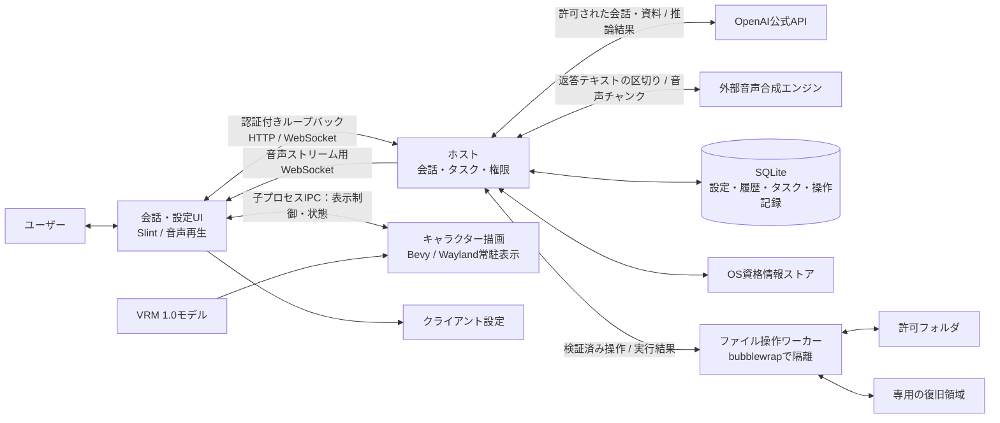

# MVPアーキテクチャ

クライアントとの現行通信は[Connect RPC＋音声専用WS](connect-rpc.md)で実装しています。サービスのpackageは`ene.host.v1`です。

本書は、[MVP](../product/mvp.md)を実装するための技術選定と責務の境界を定めます。[構想](../product/vision.md)と[機能一覧](../features/README.md)は将来の完成像として維持し、長期記憶、Windows・macOS対応、リモートホストなどを今回の実装範囲へ追加しません。

Linuxの単一PC上で、ホスト、会話・設定UI、キャラクター描画を分離します。アプリ本体はRust、UIはSlint、永続化はSQLiteとし、常駐時の消費資源と配布依存を抑える構成を選びます。実際のメモリ使用量や接続品質は未計測であり、技術の採用と動作確認の完了は区別します。

選定理由、既存製品との比較、公式資料は[参考元のMVP技術選定](../research/references.md#mvp-technology)に集約します。クライアントとホストの現行通信は[Connectの契約と境界](connect-rpc.md)、将来機能は[APIの機能拡張方針](api-roadmap.md)に定めます。

公開入口、所有権、通信、同期、画面反映の具体的な不変条件は[安全性を引き継ぐ共通境界](framework-boundaries.md)で定めます。

## 実装の責務

`ene-rpc`はhost.protoから生成するRPC型、`ene-ipc`は描画専用データ契約、`ene-plugin`はLuau／Extismのmanifest・拡張API・worker契約を持ちます。3クレートは通信の目的ごとに責務を分けます。Remocの接続と具体的なチャネルはruntime／avatar／desktopが所有します。`ene-api-client`は生成クライアント、通知同期と設定保存の進捗、`ene-outbound`は認可付き外部HTTPを担当します。`ene-core`は生成RPC型を直接使い、会話・設定・認可・保存の処理手順とportを持ちます。Axum、SQLite、Rig、keyring、OSパスや子プロセスの実装はホスト側のアダプターに置きます。

ホストの`bootstrap.rs`でportの実装を組み立て、`infrastructure/`にSQLite・資格情報・実行領域・プロバイダー接続を配置します。APIはリソース別Routerを`nest`で組み立て、application経由で操作します。DB確定後の通知とスナップショットの境界、冪等受付と保存のトランザクション、許可解除と生成開始の競合制御は分離後も維持します。デスクトップは端末設定とXDGパス解決、HTTP、通知・再接続、設定操作、描画プロセスの監督を担当し、アバターは読込・描画・Wayland操作に限定します。

組込OpenAI公式APIとプラグインのLLMサービスは同じLLM portを実装し、registryがIDで選びます。プラグインはユーザーのディレクトリでLuau／Extismのmanifestを発見し、有効化後にene-plugin-runtimeがrunnerの寿命と隔離を管理します。manifest・拡張API・worker契約はene-pluginに置き、runtimeとrunnerのRemoc接続は実行側が所有します。Luauは拡張API、ExtismゲストはPDKのJSON入出力を使います。モデルやプラグイン管理の公開RPCデータはene-rpcの生成型を共有します。外部HTTPはホストのbrokerに限定し、現在の許可を送信ごとに再確認して資格情報を付与します。直接のネットワーク・ホストDB・資格情報・ホームは公開せず、隔離できない場合は起動を拒否します。実装と送信条件の変更は許可のfingerprintへ反映します。Task・ファイルworker・音声はこの境界を用いる後続実装です。

## ソースの配置

`src/main.rs`は起動と依存の組み立てに絞り、処理は責務を持つモジュールへ配置します。分割後も公開APIと設定・通信・保存形式を維持します。

| 対象 | 配置と責務 |
| --- | --- |
| `apps/ene-desktop/ui/` | `app.slint`はRust向け公開入口、`shell/`はウィンドウ、`foundation/`はテーマとアイコン、`state/`は型と状態、`widgets/`は共通部品、`pages/`は画面固有の部品。詳細は[UIの配置](../../apps/ene-desktop/ui/README.md) |
| `apps/ene-desktop/src/application/` | 画面操作の登録、会話、端末設定、アバター操作、終了・トレイのライフサイクル。`host/`は接続操作、AI設定、イベント処理、スナップショットの画面反映 |
| `apps/ene-desktop/src/infrastructure/` | アバタープロセス監督、ファイル選択、XDG、トレイ。`host/`はHTTP・通知・再接続とホスト起動・監視 |
| `apps/ene-desktop/src/settings/`・`presentation/` | 設定の永続化と編集状態、検索セレクターと画面の回帰テスト |
| `apps/ene-avatar/src/render/` | モデル検証、モーション、Bevyシーン。`gpu/`はフレーム転送・入力マスクと表示、`renderer/`は初期化・モデルとカメラ・アニメーション |
| `apps/ene-avatar/src/wayland/` | layer-shellの状態と配置、出力イベント、ポインター入力、ネイティブハンドル |
| `apps/ene-host/src/api/`・`infrastructure/` | リソース別HTTPルートと、保存・実行領域・資格情報・LLMの実装。`sqlite/`は接続実行、スキーマと復旧、読み出し、repository port、設定・受付・メッセージのトランザクション |
| `crates/ene-core/src/application/` | `operations/`は設定変更・許可・送信受付・接続確認・プロバイダー操作。`generation/`は実行状態、資格情報の復旧、送信時の認可、ストリーミング。`runtime`は受付・所有権・終了待ち、`commit`は保存と通知の共通境界 |
| `crates/ene-api-client/src/` | 通信とレスポンス境界、リソース別操作、通知同期セッション、設定保存の進捗、エラー、冪等キー |
| `crates/ene-outbound/src/` | 外部HTTPの認可、資格情報の付与、転送・再送禁止、受信・SSE容量の制限、Rigへの接続 |

テストは対象モジュールの配下へ置き、デスクトップの画面テストはナビゲーション、返信表示、AI設定、コンパニオン、ホスト管理に分けます。

## スタックの依存順序

#1 contracts → #2 avatar → #9 client → #13 ene-plugin／Luau・Extism SDK → #10 core → #12 runtime → #4 host → #5 desktop の順に構築します。Coreのplugin portは#13のene-pluginを参照し、RPCのModelや管理データはene-rpcの生成型を使います。Desktopサービス、音声エンジン、タスクの実アダプターは既存のportと契約を拡張して追加します。

## 採用する技術

| 領域 | 採用方針 | 担当範囲・選定理由 |
| --- | --- | --- |
| アプリ本体 | Rust | アプリ用のPythonランタイムを配布せず、ホスト・UI・ワーカーを共通の言語で構築する |
| ホスト | Tokio＋Axum | 非同期のAI通信、タスク管理、ローカルHTTP・WebSocketを扱う |
| AI接続 | Rig | プロバイダー接続、ストリーミング、ツール呼び出しの受け渡しを利用する |
| タスク制御 | ene自身の実行ループ | 権限、停止、操作の直列化、記録、結果確認をモデル接続から独立して管理する |
| 会話・設定UI | Slint＋Winit＋FemtoVG/WGPU | 宣言的なUIと独自コンポーネントで外観を作り、WebViewを使わない |
| キャラクター描画 | 別プロセスのBevy＋bevy_vrm1 | VRM 1.0の描画・モーションに既存基盤を利用し、UIのイベントループから分離する |
| Linux常駐ウィンドウ | Smithay Client Toolkit＋wlr layer-shell | ネイティブWayland上の配置・入力領域をOS連携側で扱う |
| 永続化 | SQLite＋rusqlite | 単一ホストのデータを管理し、別DBサーバーを常駐させない |
| 認証情報 | keyring-core＋OSの資格情報ストア | APIキーなどを通常の設定や履歴から分離する |
| 音声 | 外部の音声合成エンジン＋rodio | アダプターで接続差を吸収し、逐次合成・配信・再生を優先する。エンジンとコーデックは接続・遅延の検証で選定する |
| ファイル操作 | Rustの専用ワーカー＋bubblewrap | Linuxの隔離機構と操作ごとの検証で許可範囲を強制する |

Slintの既定機能を無効にし、WinitとFemtoVG/WGPUを明示的に選びます。LinuxではWayland用バックエンドを使い、Qtの自動選択を避けます。`.slint`はビルド時にコンパイルし、実行時のUIインタープリターを導入しません。アプリ自身の実行にPython・Electron・WebViewは用いません。

Rigの自動エージェント実行へ権限やファイル操作を委ねず、モデルが返したツール要求をeneが検証して実行します。ライブラリの不要な機能を無効にし、採用バージョンと依存関係の整合は実装開始時に固定します。SlintはRoyalty-free Licenseを利用し、アプリ内に利用表示を設ける方針です。各依存のライセンスと配布物はビルド構成に合わせて記録します。

出典：[UIの比較と採否](../research/references.md#mvp-ui)、[Rust実行基盤とVRM描画](../research/references.md#mvp-runtime)。

## プロセス構成と責務

| 構成要素 | 所有する状態と責務 | 終了・切断時の動作 |
| --- | --- | --- |
| ホスト | AI接続、コンパニオン設定、会話、許可、タスク、履歴、最終報告 | UIが切断されても作業を継続する。ホスト停止後のタスク自動再開はしない |
| 会話・設定UI | 入力、会話・進捗表示、停止、設定、音声再生、テーマや位置などの端末設定 | クライアント終了時は音声と描画を終了する。ホストは終了しない |
| キャラクター描画 | VRM、描画資源、モーション、常駐ウィンドウ、入力領域 | UIが管理する子プロセスとし、クライアント終了時に終了する |
| ファイル操作ワーカー | 許可範囲の操作と復旧用コピー | ホストからの許可と停止状態に従い、実行結果を返す |

Linuxのホストはsystemdのユーザーサービスとして稼働させます。会話画面を閉じる操作は画面の非表示とし、クライアント全体の終了と区別します。描画の異常終了はUIに表示し、ホストのタスクを終了させません。

UIのメインスレッドはSlintのイベントループを担当します。通信、合成、DB処理、ファイル処理をそこで待たず、非同期処理からの更新はSlintのイベントループへ渡します。キャラクター描画とのIPCで画像フレームを転送せず、モデル指定、位置、表示状態、モーション制御、入力・エラー通知を受け渡します。APIキーや作業対象資料は描画プロセスへ渡しません。

`ene-avatar`と`ene-desktop`は`ene-ipc`の`renderer` featureと直接のRemoc依存を使います。描画プロセスはIDごとに専用ワーカー、Wayland接続・イベントループ、Bevy描画資源を管理します。共通FPSは全ワーカーへ適用し、削除は対象ワーカーの終了と資源解放を待って通知します。設定UIは1体を操作し、表示切替を追加・削除へ、30/60fpsの選択を共通描画設定へ接続します。

Rust製の親子プロセス間IPCはRemocを共通基盤とします。`ene-ipc`は描画契約型を提供します。具体的なRendererClientのチャネル型とRemoc接続はavatar／desktopが所有します。AvatarIdはdesktopが単調増加するu64を発行し、削除や描画プロセス再起動をまたいでも再使用しません。標準入出力上で `remoc::Connect::io` の `provide`／`consume` を使い、要求・通知・状態のチャネルを持つ `RendererClient` を一度渡します。通信タスクの駆動と終了はRemocへ任せます。要求と通知はremote MPSC、共通設定とIDごとの最新状態は `RendererState` にまとめてremote watchで扱います。別チャネル間の到着順には依存せず、状態の正本はwatchのスナップショットです。BevyのPluginにアバター管理をまとめ、Entity／Componentで寿命、Resourceと変更検知で共通設定を管理します。メインスレッドのcustom runnerはpluginのfinish／cleanupを行い、登録済みシステムへ要求を直接渡します。非同期通信はTokio runtimeが担当します。接続設定・codec・項目上限・バッファはRemoc標準を使います。

将来のワーカー・内部プラグインは、Luau／Extismの拡張APIとサービス契約をene-pluginに追加します。通信の具体的なRemocチャネル、実行の寿命、取消とworker回収はene-plugin-runtime／runnerが所有します。ene-ipcは描画専用のまま維持します。取消や切断を、適用済みファイル変更の取り消しとは扱いません。端末・公開ホストAPIはene-rpcの生成Connect契約を使います。

採用理由と比較は[内部IPCの比較と採否](../research/references.md#internal-ipc)を参照してください。

MVPの表示は1体ですが、`ene-ipc::renderer`の共有契約は同じ描画プロセス内の複数アバターを扱える形にします。各アバターは専用の透明な常駐ウィンドウを持ち、共通の`RendererConfig`と個別の`AvatarConfig`を分離します。desktopが追加時に発行する単調増加のu64を`AvatarId(pub u64)`で包み、個別操作・状態・イベントを識別します。削除するまで同じIDを保持し、削除後や描画プロセスの再起動後も同じ描画セッションでは再使用しません。名前やモデルを変更してもIDは変えません。人格・会話などの永続データを識別する`CompanionId`とは分離し、同じコンパニオンの複数表示も別の`AvatarId`で扱います。OSのウィンドウIDはIPCに公開しません。

`RendererRequest`は共通設定と初期アバター一覧による初期化（空一覧も可）、共通描画設定の更新、個別アバターの追加・削除・設定更新・再配置、全体終了を提供します。初期アバターは`AvatarInstance`にID・設定・配置をまとめます。`AvatarId`はu64として送受信します。`validate()`を呼び、初期一覧の重複IDと不正な表示サイズを状態変更前に拒否します。追加時の既存IDと個別操作の未知IDは描画実装が実行時にエラーとして扱い、既存アバターを上書きしません。追加・削除は対象ウィンドウとその資源に適用し、個別設定の更新は配置を変更しません。`Recenter`は対象アバターの表示先モニターを維持し、ウィンドウをそのモニター全体の中央へ移動します。論理サイズを使って`x = (モニター幅 - ウィンドウ幅) / 2`、`y = (モニター高さ - ウィンドウ高さ) / 2`を計算し、移動後の配置を`AvatarState`で通知します。`Shutdown`は全ウィンドウを解放してプロセスを終了します。子側ではTokioのUnix pipe APIを使い、親が接続を保持していても終了できるようにします。終了完了はクライアントが子プロセスの終了と終了コードで確認し、IPCの状態に停止フラグは設けません。アバター一覧が空でもプロセスは稼働中として扱います。

`AvatarPlacement`はアバターウィンドウの左上位置を`x / y`で保持します。原点は`monitor`で指定したモニターの左上、単位は論理ピクセルとし、右方向に`x`、下方向に`y`が増えます。負の座標も扱い、出力端をまたぐ配置を表現できます。`monitor`がない場合はクライアントが選ぶ既定出力を使います。型の既定値は左上から`(24, 24)`です。初回に右下へ配置する場合は、クライアントが出力とウィンドウの論理サイズから`x = max(0, 出力幅 - ウィンドウ幅 - 24)`、`y = max(0, 出力高さ - ウィンドウ高さ - 24)`を計算します。実装は左上アンカーと上・左の余白で座標を適用します。

`RendererState`は共通描画設定とIDごとの個別状態をまとめてremote watchで配信します。初期化前の共通設定は `None` です。`RendererMessage`は`MotionFinished`イベント、資源解放後の削除完了、任意のアバターIDと説明を持つエラーを通知します。アバターの表示は追加・削除で管理し、追加されたアバターは表示対象とします。一時的な非表示設定は設けず、削除時にウィンドウと描画資源を解放します。再表示に必要な設定はクライアント側で保持し、再追加時に読み込み直します。`AvatarState`は読み込み中かどうかとエラーを通知します。`AvatarConfig.motion_playing`は選択したモーションの再生・一時停止を指定し、`motion_loop`で繰り返しを指定します。モーションの状態は未選択・読み込み中・再生中・一時停止中・完了・失敗を扱います。モーションの読み込み・再生に失敗した場合は`MotionState::Failed { message }`で説明を通知し、独立した`motion_error`フィールドは設けません。失敗後に以前のモーションの再生を継続する動作は想定しません。モデルの読み込み状態とエラーは`AvatarState.loading`と`error`で別に扱います。今後、操作や振る舞いの実装に伴って多数のアバターイベントが追加される可能性がありますが、追加のイベント型と通知は対応する機能の導入時に定義します。エラーのIDがない場合はプロセス全体のエラーです。受信した要求のIDと設定を検証し、デコードや通信の失敗は接続を終了して通知します。

出典：[ホストと接続の設計](../research/references.md#mvp-host)、[既存製品から採用する構造](../research/references.md#mvp-products)。

## 対話・作業・音声の流れ

1. UIからホストへ設定を登録します。AIへの会話・資料送信と、選択した音声合成接続先への返答テキスト送信について、データの種類・用途・送信先を提示して許可を得ます。
2. フォルダ単位で読み取りのみ、または編集を含む許可を登録します。任された範囲内では、操作のたびに承認を求めません。
3. コンパニオンが依頼の目的を整理し、自身に属するTask（独立したLLMセッション・サブエージェント）へ確定した指示を渡します。Taskは同時に1件です。
4. 作業セッションが返したツール要求をホストが検証し、ワーカーで直列実行します。進捗は操作記録と実行結果から生成します。
5. 作業中の雑談は会話セッションで扱います。作業からの質問への回答は該当タスクに渡し、通常の雑談を作業目標へ混入させません。判断が必要な工程は回答待ちにします。
6. 実際の変更を検証して最終報告を保存し、同じコンパニオンから伝えます。完了後の修正は、新しいタスクとして受け付けます。

会話用と作業用のモデル設定は分離可能にしますが、確認構成では双方にOpenAI公式APIの`gpt-6-luna`を使用します。組込プロバイダーは`https://api.openai.com/v1`へ直接接続し、Responses APIを利用します。送信許可の宛先は`https://api.openai.com`です。OpenRouterは追加プラグインとして利用し、OpenAI限定・フォールバック禁止の条件をホスト側でも検証します。接続失敗を隠すために別モデルや配信先へ自動切り替えしません。

音声合成は、許可された外部エンジンへホストから依頼します。特定のエンジンやWAVに固定せず、アダプターで認証、声の指定、テキスト入力、音声出力の違いを吸収します。クライアントは生成中の返答の音声を要求でき、読み上げ可能な文・句が確定した時点から合成・配信・再生を並行して進めます。全文や音声全体の完成を待たず、届いた音声チャンクからrodioで再生する構成を検証します。テキスト逐次入力、音声逐次出力、合成キャンセルの対応能力を区別し、初回再生の遅延、途切れ、中断性能を測定して検証用構成を1系統選びます。VOICEVOXは参考候補です。

読み上げをオフにした場合や音声接続の切断時は合成・配信待ちを取り消し、クライアントは再生バッファと遅着音声を破棄します。エンジン側で取消不能な計算まで停止済みとは報告しません。再接続時に過去の返答をまとめて読み上げず、音声の中断・失敗でもテキスト会話とTaskは継続します。音声の形式、連番、発話の寿命は[音声ストリームの契約](api.md#音声ストリーム)に従います。

ホストとの要求・状態取得と通知は認証付きConnect RPCを使います。音声は通知用とは別のWebSocketで要求・配信・中断を扱い、音声の送信待ちで停止や状態通知を妨げません。認証なしのローカル要求も拒否し、認証情報をURLやログへ含めません。作業開始と相談回答はコンパニオンのメッセージAPIを通し、要求IDと元の依頼により重複実行を防ぎます。通知には起動ごとの識別子と連番を付け、切断後は購読を開始してから状態スナップショットを取得して再同期します。通知だけを結果の保存先にしません。

停止はAI応答とは別の制御経路で受け付けます。タスクは実行中、回答待ち、停止処理中、完了、失敗、キャンセル終了を区別します。一時停止と再開はMVPに含めず、停止後の続行は新しい依頼です。作業中の一般的な方針変更は、必要な回答の補足でなければ停止して新しい依頼として扱います。

出典：[AIと音声の確認用構成](../research/references.md#mvp-reference-config)、[音声と認証情報](../research/references.md#mvp-audio)。

## かわいいUIとOS対応

会話・設定UIにはSlintの独自コンポーネントを使います。丸み、配色、余白、文字、アイコン、短いアニメーションを共通のテーマで管理し、外観を変更しても入力、進捗、停止の操作を見失わない構成にします。

標準アイコンにはCargoのビルド依存`lucide-slint`を使います。`ui/foundation/icons.slint`が用途名（`Icons.avatar`など）とライブラリの図柄を対応付け、`IconData`を共通の`Icon`で描画します。追加時は既存の用途名とLucideの収録アイコンを確認し、適切な図柄がないene固有の表現だけを自作します。標準SVGやライブラリの生成済みソースをリポジトリへコピーせず、配色・サイズ・線幅も共通部品で管理します。

カスタマイズ対象はテーマ、フォント、色、背景の透明度、画像素材、パネル配置、サイズ、キャラクターの位置・表示サイズとします。これらと読み上げのオン・オフはクライアント側に保存します。Luau／Extismによる拡張は共通のプラグイン契約で管理し、Desktopサービスへの公開は後続実装とします。

会話・設定は1つの通常ウィンドウ内で切り替え、キャラクターは別の透明な常駐ウィンドウとして表示します。画面構成、レスポンシブ配置、設定の所有者と保存操作は[デスクトップUI設計](desktop-ui.md)に定めます。LinuxはネイティブWaylandを使い、最初の実機検証環境をKDE/KWinとします。XWaylandへの切り替えを前提にしません。

キャラクターのLinuxウィンドウはSmithay Client Toolkitとwlr layer-shellで扱います。画面の作業領域を占有せず、キーボードフォーカスを奪わない配置にし、描画の透明度だけでなくWaylandの入力領域で透明部分のクリック透過を実現します。位置は出力とアンカー・余白で管理し、ドラッグ、DPI、モニターの追加・取り外しに対応させます。Bevyのオフスクリーン画像を同じWGPUデバイスからSCTKのWayland surfaceへ表示します。通常動作では画像をCPUへ戻さず、最終画像をGPUで走査してalpha由来の水平区間だけを取得します。3枠のGPU画像と座標バッファを再利用し、フレーム番号・世代・寸法・DPIが一致する画像と入力領域を一つのWayland commitで反映します。容量不足は同じ画像から再生成し、リサイズ中も表示中の画像と領域の対応を維持します。[描画設計](avatar-gpu-rendering.md)を参照してください。UIと描画プロセスのIPCでは画像を転送しません。VRMAの骨の互換変換とアプリの配置を分離し、腰の静止位置をカメラの軸とします。足の接地を崩さないよう腰の水平・上下移動と回転を保持し、ウィンドウの配置やカメラをモーションに追従させません。

| OS別に分離する領域 | LinuxのMVP | 将来のWindows・macOS |
| --- | --- | --- |
| 常駐表示と入力 | Wayland・layer-shell、入力領域、出力配置 | 透明表示、クリック透過、位置、DPIを各OSのAPIで実装 |
| 資格情報 | Secret Service | Windows Credential Manager・macOS Keychainに対応するストア |
| ホストサービス | systemdユーザーサービス | 各OSの起動・サービス管理へ置き換え |
| ファイル隔離 | bubblewrap＋制限付き操作 | 同じ許可境界を満たすOS別の隔離・操作実装 |

UIや描画ライブラリの対応OSと、eneの常駐動作が検証済みかは別に管理します。layer-shell非対応のLinux環境や未実装のOS機能は利用不可と明示し、制限を外して動かすフォールバックは設けません。すべてのLinux環境での動作保証はMVPの対象外です。

出典：[UIの比較と採否](../research/references.md#mvp-ui)、[Waylandと描画の連携](../research/references.md#mvp-wayland)。

## 権限・ファイル操作・復旧

[権限とデータの管理](../features/settings/permissions.md)に従い、許可範囲は実行側で強制します。モデルから渡されるパスや操作内容を、そのまま信頼しません。

操作は許可フォルダ内のUTF-8の`.txt`・`.md`を対象とする一覧取得、読み取り、フォルダ作成、ファイル作成、本文編集、移動、名前変更に限定します。本文を扱えない形式や文字コードは理由を伝え、任意のシェル実行、GUI操作、完全削除は提供しません。

Linuxワーカーはネットワークを隔離し、実行に必要なランタイムの読み取り専用領域、許可フォルダ、専用の復旧領域、最小限の一時領域だけを利用できる構成にします。読み取りのみの許可では対象を読み取り専用にします。ホーム全体、ホストDB、資格情報、無関係なファイルやIPCソケットを公開しません。bubblewrapを起動するだけで安全とせず、マウントと操作検証の両方を確認します。

- 操作パスは許可ルートに対する相対指定とし、範囲逸脱、シンボリックリンク経由のアクセス、特殊ファイルを拒否します。検査後の差し替えによる逸脱も防ぐ方法を先行検証します。
- ファイル操作は直列実行し、名前の衝突、読み取り後の外部変更、既存データへの上書きを検出します。競合した場合は処理を止め、理由を報告します。
- 変更前にファイル内容と元の配置を復旧用に保持し、ホストが操作の予定を永続化してから実行を許可します。ワーカーは結果を返し、実際の内容・配置を検証して操作記録を確定します。記録やバックアップに失敗した場合は変更を開始しません。
- 停止・権限解除を受けたら、ホストとワーカーの実行制御で新しい関連操作や外部送信を開始しません。すでに実行中の処理は成否を確認して記録し、それまでの変更範囲を報告します。
- 接続エラー、書き込み失敗、名前の衝突、成否不明の操作を完了扱いにしません。停止しても、適用済みの変更や送信済みデータを自動的に取り消したとは報告しません。

SQLiteのトランザクションは、作業フォルダのファイル変更まで原子的にしません。変更前のコピー、操作の予定・結果、実際のファイルを照合し、ホスト停止をまたいだ未確定操作は自動再試行せず、中断状態と適用済み範囲を確認します。復旧操作も既存ファイルとの衝突を確認し、黙って上書きしません。

出典：[隔離機構と権限](../research/references.md#mvp-safety)、[SQLiteと記憶検索](../research/references.md#mvp-storage)。

## 永続化と将来の記憶

### MVPで保存するもの

ホストだけがSQLiteを所有し、設定、会話履歴、許可、タスク、操作記録、最終報告を保存します。DBアクセスは専用スレッドへ集約し、同期的なrusqliteの処理でTokioやSlintのイベントループを止めません。書き込みは直列化し、トランザクションは短く保ちます。

DBはホストと同じPCのローカルストレージに置き、クライアント・描画プロセス・ファイルワーカーに直接開かせません。将来クライアントが増えてもホストのAPI経由でアクセスし、DBファイルをネットワーク共有しません。SQLiteは組み込み構成を選び、OSごとのSQLiteバージョン差を配布時に持ち込みません。

クライアント固有の外観・位置・音声設定はローカル設定として分離します。APIキーなどの認証情報はOSの資格情報ストアへ保存し、SQLite、通常の設定ファイル、会話・操作ログには平文で保存しません。ストアが利用できない場合はセッション中だけ保持し、永続保存されたように表示しません。

### 記憶の正本と検索索引

**将来の記憶の正本はSQLiteに保存し、検索索引は再構築・交換できる構成にします。** 長期記憶の抽出・整理・意味検索は今回実装しません。MVPの会話ログを、長期記憶が完成したものとして扱いません。

[記憶機能](../features/memory/README.md)に従い、将来は本文、分類、所有コンパニオン、共有範囲、出典、日時、重要度、訂正の関係を保持できる設計を採ります。個別記憶と共有記憶は参照範囲を区別し、共有された事実を自分自身の体験として扱わないため、取得した経緯も保持します。

訂正は古い情報との関係を残して最新の情報を優先し、「忘れて」は既存仕様どおり想起優先度を下げます。これらは記憶の正本の状態として保存し、検索方式を変えても維持します。取得時は参照可能な範囲を守り、関連性・重要度・新しさを評価します。過去の記憶を根拠に実行権限を拡張しません。

| 責務 | 方針 |
| --- | --- |
| 保存 | SQLiteで記憶本体、根拠、所有者、共有範囲、訂正・優先度を保持 |
| キーワード検索 | FTS5を候補にし、日本語の分割方法と短い名前・単語を検証して選定 |
| 意味検索 | 埋め込みとベクトル検索を候補にする。sqlite-vecは評価候補であり、MVPでは導入しない |
| 選別 | アプリ側で参照範囲、関連性、重要度、新しさを評価 |
| 再構築 | 記憶本体から検索索引を作り直せるようにし、索引だけに事実や訂正状態を保存しない |

SQLiteは同時に1つの書き込みを扱うため、ホストが保存を一元管理する今回の構成を前提にします。複数ホストからの大量の同時書き込み、検索速度、メモリ使用量の実測で必要性が確認された場合に、別DBや検索エンジンへの移行を検討します。記憶全体を常時RAMに展開することや、専用のベクトルDBサーバーの常駐を初期要件にはしません。

出典：[SQLiteと記憶検索](../research/references.md#mvp-storage)、[音声と認証情報](../research/references.md#mvp-audio)。

## 検証と消費資源

以下は実装後の受け入れ項目であり、本書の作成時点では実機で完了した検証ではありません。

| 領域 | 検証するシナリオと期待結果 |
| --- | --- |
| 表示 | VRM 1.0の描画・基本モーション、透明部分のクリック透過、ドラッグ、DPI・モニター変更。非対応モデルは理由を表示し、変更・終了時に資源を解放する |
| UI | 日本語IME、長文の会話表示、テーマ・配置変更。AI・合成・作業中も入力、進捗確認、停止が応答する |
| 作業 | 分類・移動・名前変更・本文編集・一覧作成を完走し、報告と実際の変更が一致する |
| 制御 | 並行会話、回答待ち、キャンセル、権限解除。停止後に新しい関連操作や送信を開始しない |
| 隔離 | 許可外パス、シンボリックリンク、特殊ファイル、差し替えによる逸脱、ワーカーからのネットワーク・秘密情報へのアクセスを拒否する |
| 異常・復旧 | 名前の衝突、外部編集、書き込み・バックアップ・記録失敗を完了扱いにしない。変更前の内容・配置を復旧できる |
| 接続・保存 | UI終了中もホストが作業を継続し、再接続で結果を確認できる。開始要求の再送で重複実行しない。ホスト停止後は中断と適用済み範囲を確認し、自動再開しない |
| AI・音声 | OpenAI公式APIの指定モデルでストリーミングとツール呼び出しを確認。選定した音声接続先の逐次合成・配信・再生、初回遅延、途切れ、中断、オフ・失敗を確認し、未許可の接続先へ切り替えない |
| 実行環境 | アプリ用のPythonやQtを別途インストールせずに起動できる。GPU・音声・Wayland・bubblewrapなど必要なOS依存を記録する |
| 将来の記憶設計 | 保存・検索の分離、個別・共有の境界、訂正履歴、優先度低下、索引再構築が既存仕様と矛盾しないことを文書で確認する |

キャラクターの表示中の待機描画は設定で30fpsまたは60fpsを選択可能にし、初期値は30fpsとします。非表示時は描画を止め、会話・設定UIは変更があるときに更新します。Bevyの不要なUI、音声、ゲームパッド等や、不要なコーデック・SDK機能を無効化します。MVPに高度な物理演算などを追加しません。

消費資源はリリースビルドで測定します。ホスト・UI・描画・動作中のワーカーを含むアプリ全体の合計PSS、GPUメモリ、CPU使用量、配布サイズを、モデルと環境を記録して比較します。表示待機の30／60fps、非表示、会話、作業中を測定対象とし、外部の音声合成エンジンやローカルLLMは別計測にします。メモリ上限は実測後に決め、未計測の数値を採用理由にしません。

Slintと描画プロセスの制御、BevyとWayland常駐ウィンドウの連携、日本語IME、入力領域、総メモリ使用量を実装前の先行試作で確認します。ライブラリの対応表だけで合格としません。実装では[MVPの機能完成条件と3日・5件の利用検証](../product/mvp.md#6-完了条件)を別に満たす必要があります。

## MVPとの対応と文書の完成条件

| MVPの項目 | 本書で対応する設計 |
| --- | --- |
| 1. 目的 | 同じコンパニオンを窓口とし、対話から作業・結果確認まで扱う |
| 2. 仮説 | 自然言語の依頼、作業中の独立した会話、履歴・結果の継続利用 |
| 3. シナリオ | 設定・許可、VRM表示、依頼、補足、進捗・停止、結果確認、新規タスクとしての修正 |
| 4. 含めるもの | 表示・UI、AI・音声、制限付きワーカー、バックアップ、ホストとSQLite |
| 5. 含めないもの | OS別境界と将来の記憶設計のみを用意し、対象外機能は実装しない |
| 6. 完了条件 | 正常系、停止、隔離、異常報告、復旧、再接続の検証項目と実利用による評価 |

文書の完成時には、採用理由と出典、上記の対応、既存の権限・ホスト・記憶仕様との整合、相対リンクを確認します。本書はプロセスと振る舞いの設計を定めるものであり、[ホストAPI設計案](api.md)とともに、API実装、通信の詳細スキーマ、Rustの型、DBスキーマを提供するものではありません。一般公開向けの配布整備は今回のMVPに含めません。

ホスト共通の接続設定と、IDで管理するコンパニオン設定は保存上も分離します。会話の受付にはメッセージIDとコンパニオンIDを保持し、コンパニオンごとに前の返答の終了保存を待ってから、最新のモデル割当・口調・接続・資格情報・許可を確定します。開始後の生成設定は固定し、送信ごとの認可は現在の許可と取消状態をメモリ上で確認します。プラグインのファイル検証は走査と隔離プロセス起動時に行い、認可ロックの保持中には読み出しません。検証済みの内容を実行用ディレクトリへ複製し、終了までその固定された内容を読み取り専用で公開します。

終了状態の保存は3回まで試行します。保存が確定しなければ未確定の実行を保持し、通知とavailabilityの`storage_error`で障害を示し、後続のモデル実行と新規会話の受付を止めます。保存先を復旧してホストを再起動すると、既存の中断回復処理が未終了メッセージを失敗として確定します。デスクトップでは操作結果を要求IDと対象で識別し、取消を通常操作と並行して受け付けます。表示用の投影は約33msごとに集約して最新の一つだけ保持し、受付確認や操作結果は個別に配送します。
