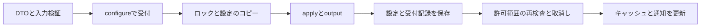

# 機能追加の共通基盤

設定変更、外部通信、画面操作を追加するときの入口です。業務上の検証と変更内容を各機能に置き、取消し・保存・通知・終了待ちは共通基盤で扱います。既存の会話・資格情報・許可・疎通確認もこの基盤を使います。終了状態はホスト本体が所有し、API層や起動処理が別の終了チャネルを用意する必要はありません。

## 動く縦断雛形を生成する

```sh
just new-feature rename_companion name
# justがない場合:
python3 scripts/new-feature.py rename_companion --field name
cargo fmt --all
cargo test --locked -p ene-host -p ene-api-client
```

生成される例は `PATCH /v1/companions/{companion_id}/rename-companion` で名前を更新します。`--field mind` なら初期人格を更新する例です。未実装の処理が成功を返す空の雛形にはせず、既存のフィールドを使って一連の処理を確認できます。機能固有の入力型・検証・変更箇所へ置き換えてください。新しい永続フィールドやエンティティは別途DTO、ドメイン、マイグレーションに追加します。

| 生成先 | 実装者が編集する部分 | 共通基盤が担当する部分 |
| --- | --- | --- |
| `ene-api-types/src/<name>.rs` | 入力のフィールドと型 | 厳格な入力解釈とOpenAPI用スキーマ |
| `ene-core/src/application/operations/<name>.rs` | 対象・revision・入力の検証、変更内容、返却値 | 受付、ロック、保存、通知、取消し |
| `ene-host/src/api/v1/companions/<name>.rs` | HTTPメソッド・パス・入力型 | 親Routerの認証、入力エラー、OpenAPIへの登録 |
| `ene-api-client/src/<name>.rs` | 型付きの呼出し | URLのエンコード、認証、通信・応答の上限 |

モジュールとRouterは生成コマンドが登録します。既存ファイルや同名モジュールがあれば、書込み前に停止します。`--dry-run` で生成・編集先を確認できます。生成したAPIのテストには保存、revision競合、OpenAPIへの登録を含みます。

`just template-check` は一時コピーに名前・初期人格の2つの機能を生成し、生成APIのテストとClippyを実行します。テンプレートは `templates/configuration/`、検証処理は `scripts/check-feature-template.py` です。

PRのCIでも整形、全workspaceのClippyとテスト、生成テンプレートの検証を実行します。共通APIを変更して雛形が古くなった場合も検出します。

## 設定変更は ConfigurationCommand を使う

`ConfigurationCommand::target` に対象と編集開始時のrevisionを宣言します。対象の存在・revision競合の検査と保存時のrevision更新は基盤が行います。`apply` は設定のコピーに対する同期処理で、機能固有の条件を検査して値を変更します。`output` は保存する設定から返却値を作ります。既存の実装例は `operations/configuration.rs` の `PatchCompanion` です。



基盤は次を保証します。

- 呼出し元の切断後も、受け付けた処理の保存・キャッシュ更新・通知を完了します。HTTP以外から呼んでも同じ寿命です。
- 検証・返却値の構築・SQL保存の失敗では、設定のキャッシュと設定更新の通知を変更しません。保存障害の通知は別途配信します。
- snapshotと通知の連番を同じ境界で管理し、保存済みデータとその通知の間にsnapshotを挟みません。
- 変更されたコンパニオン・設定・許可だけを通知します。通知の種類、所有者、ペイロードは `Change` から組み立てます。
- 保存された許可が実行中の送信範囲を満たさなくなったら、その処理を取消します。許可を戻しても取消し済みの実行は復活しません。

資格情報のストアや外部APIなど、非同期の処理が必要なコマンドは `HostApplication::execute` で寿命を確保し、portを呼びます。既存の資格情報登録・設定保存が実装例です。`configure` の中から別のコマンドを呼ばず、`apply` と `output` にI/Oを入れません。共通基盤のロックを保持したまま待つことを防ぐためです。

作成・外部実行に再送の可能性がある場合は、同じキー・対象・入力の受付記録を先に確認します。設定の保存と受付記録は `ReceiptWrite::Create`、予約済み記録の完了は `ReceiptWrite::Complete` を同じコミットで処理します。完了処理は現在の認証主体と元の入力を検査し、予約中の1件だけを更新します。受付の曖昧さを新しいキーによる再実行で解消しません。

## 外部処理は Operation から送信範囲を決める

現在の用途は `Conversation`、`ConnectionCheck`、`ModelList` です。用途ごとの許可、データ種別、タイムアウトを `generation/authorization.rs` の `Operation` にまとめています。機能側で用途文字列とデータ種別を別々に構築しません。

| 共通処理 | 担当する保証 | 実装例 |
| --- | --- | --- |
| `prepare` | 終了・保存障害・同時実行上限・資格情報・送信許可を検査し、実行範囲と取消しチャネルを作る | `operations/messages.rs`、`checks.rs`、`providers.rs` |
| `invocation` | 実行範囲から認可を参照し、各外部送信で現在の許可・資格情報・実装を再検査する | 組込OpenAI、隔離プラグインの同じport |
| `Operation::wait` | 取消し・ホスト終了・時間上限を共通で扱い、完了と競合する取消しを優先する | 生成、疎通確認、モデル取得 |
| `TaskTracker` | 受け付けたコマンドと生成・モデル取得の終了を待つ | `HostApplication::request_shutdown` / `stop` |

実行枠は、永続的な終了状態を保存してから解放します。保存できなければ故障した実行を保持し、以後の外部処理を拒否します。疎通確認の結果保存にも同じ規則を適用します。会話の受付、待機順、文脈の構築、ストリームの保存は既存の `messages.rs` と `streaming.rs` を使い、プロバイダー追加では `LlmProvider` と隔離プラグインの通信契約を実装します。

## 画面操作は Command と OperationTarget に登録する

`ene-desktop/src/infrastructure/host/contracts.rs` の `Command::policy` と `OperationTarget::policy` が、対象、書込みキュー、下書きの保存、表示カテゴリ、処理状態を定義します。取消し操作は `urgent` として通常操作の待ち状態でも受け付けます。機能を追加する際はCommandの型と対象を追加し、対象のpolicyを定義します。網羅的なmatchなので、新しい対象に必要な分類を忘れるとコンパイルで検出できます。

既存の設定セクションとフォーム部品を利用し、`host_request` を通して要求します。要求ID・コンパニオン・対象・編集revisionによる遅着応答の判定、同じ下書きの新規接続IDの維持、保存された下書きだけの解除は既存のControllerと投影処理を使います。再接続中も、受付済みの書込みは同じMutationQueueで順序を維持します。

## 新しいドメインに残る設計判断

この基盤は新しい機能の意味までは決めません。Task・音声・ファイル操作などでは、所有者、状態遷移、必要な権限、永続化する結果、失敗からの復旧方法を機能の型とportに定義します。外部処理の自動再実行や同時実行数の増加は、重複実行と競合の制御が実装されてから有効化します。描画・IPC・音声は対応する既存のプロセス境界を維持します。

変更した挙動に応じて、revision競合、保存失敗、切断、取消しと完了の競合を検証します。汎用部分の回帰テストは `api/tests/framework.rs`、通知同期は `ene-api-types::sync`、GPU／WaylandとIMEの実機確認は各設計文書に従います。
