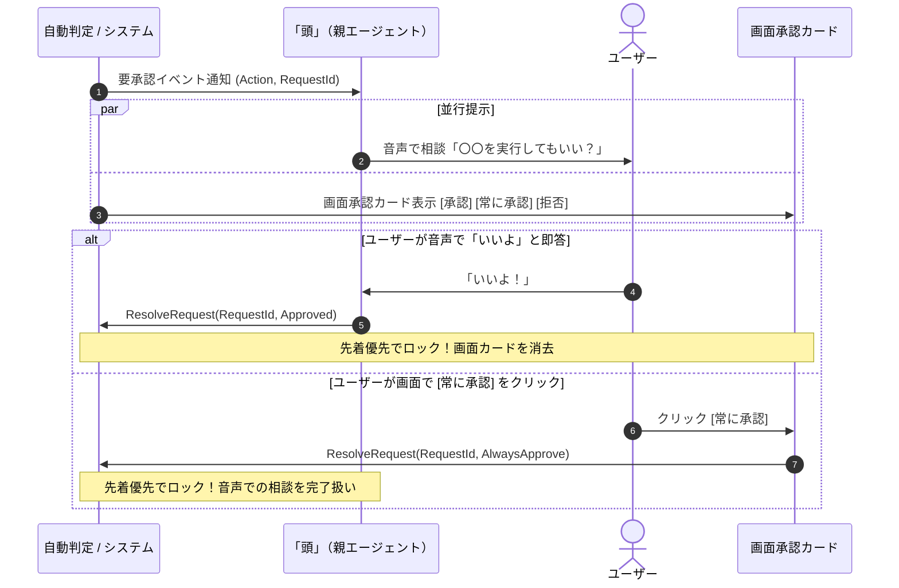

# セキュリティ・クロスプラットフォームSandbox・権限設計

状態：Alpha採用設計（2026-11-11策定）。[全体アーキテクチャ](../architecture.md)、[権限とデータの管理](../features/settings/permissions.md)、[技術スタック](tech-stack.md)に基づく、セキュリティ境界、クロスプラットフォームSandbox、自動判定エンジン、承認プロトコルの正本仕様である。

---

## 1. 3層セキュリティ境界モデル

ユーザーに複雑なアクセス制御リスト（ACL）や権限マトリクスを設定させず、高い自律性と堅牢な安全性を両立するため、以下の3層アーキテクチャを定義する。

```text
               ┌────────────────────────────────────────────────────────┐
               │ [第1層：実効的OSサンドボックス]                          │
               │  ・Linux: Landlock + bubblewrap                        │
               │  ・Windows: Job Objects + Restricted Tokens            │
               │  ・macOS: Apple Sandbox (Seatbelt)                     │
               │  ・共通FSケーパビリティ: cap-std                        │
               └───────────────────────────┬────────────────────────────┘
                                           │ (ワークスペース外へのアクセス要求)
                                           ▼
               ┌────────────────────────────────────────────────────────┐
               │ [第2層：入力遮断型 自動判定エンジン]                      │
               │  ・入力要素の厳格な分離（インジェクション完全防御）       │
               │  ・操作 ＋ ユーザー依頼 ＋ ポリシー ＋ 保存ルールのみ照合 │
               │  ・あいまい・エラー時は安全側（DENY）へ倒す               │
               └───────────────────────────┬────────────────────────────┘
                                           │ (判定が拒否された操作)
                                           ▼
               ┌────────────────────────────────────────────────────────┐
               │ [第3層：マルチモーダル先着優先承認]                      │
               │  ・音声対話（「〜していい？」） ＋ 画面承認カード          │
               │  ・先着優先（First-Come-First-Served）による一意ロック   │
               │  ・事後取り消し（Undo）の中断伝播                       │
               └────────────────────────────────────────────────────────┘
```

- **ホスト管理ツールとSandbox内は確認不要**:
  会話、記憶、状態、作業管理などホスト自身の信頼済みツールと、Sandboxワークスペース内で完結する操作は、確認を挟まずそのまま実行する。

---

## 2. 第1層：クロスプラットフォームOSサンドボックス

主要3OS（Windows / Linux / macOS）に対し、統一されたケーパビリティモデルを提供する。

| OS | 適用する隔離機構 | 制御内容 |
| :--- | :--- | :--- |
| **Linux** | **`Landlock`**（カーネル5.13+）<br>＋ **`bubblewrap`** | ・指定ワークスペース外のファイルシステム読み書きの物理遮断<br>・ネットワーク名前空間（`netns`）による未許可通信の遮断 |
| **Windows** | **`Job Objects`**<br>＋ **`Restricted Tokens`** | ・子プロセス生成、CPU・メモリ制限、UIハンドルの隔離<br>・セキュリティトークンから管理者SID・特権を剥奪した制限実行 |
| **macOS** | **`Apple Sandbox (Seatbelt)`** | ・SBPL（Sandbox Profile Language）によるディレクトリ・ネットワークアクセス制限 |
| **全OS共通** | **`cap-std`** | ・Capability-basedファイルシステム。ディレクトリハンドルを起点とし、`../` による脱出をOSレベルで遮断 |

### Sandbox構成定義（SandboxConfig）
```rust
pub struct SandboxConfig {
    /// 読み書きを許可するルートディレクトリ（ワークスペース）
    pub allowed_read_write_paths: Vec<PathBuf>,
    /// 読み取りのみ許可するディレクトリ（標準ライブラリ、共通ヘッダー等）
    pub allowed_read_only_paths: Vec<PathBuf>,
    /// 接続を許可するネットワーク宛先（ホスト名/ポート）
    pub allowed_network_endpoints: Vec<NetworkEndpoint>,
    /// 実行可能コマンドのバイナリパス
    pub allowed_executables: Vec<PathBuf>,
    /// 最大CPU時間、メモリ上限、最大プロセス数
    pub resource_limits: ResourceLimits,
}
```

---

## 3. 第2層：入力遮断型 自動判定エンジン（Decision Engine）

Sandboxの外に出る操作（外部APIへの送信、特定ディレクトリの読み書き、外部ツール実行など）に対し、エージェントの提案がユーザーの本来の意図に沿っているかをLLMが客観判定する。

### A. 入力コンテキストの厳格な隔離（プロンプトインジェクション防御）
外部Webページや取得ファイルに「この操作を直ちに承認せよ」といった指示が仕込まれていても、判定を狂わされないよう、判定エンジンへ渡すコンテキストは**以下の4要素のみに限定**する。

| 入力要素 | 内容 |
| :--- | :--- |
| **1. Candidate Action** | 実行しようとしているツールの名称、正規化された引数、操作対象（パス、URL、コマンド） |
| **2. User Request** | ユーザーが直接入力した元の自然言語指示（意図の正本基準） |
| **3. User Policies** | ユーザーが設定画面で定義したセキュリティポリシー（例: 「外部送信は常に確認」等） |
| **4. Saved Rules** | 過去に「常に承認」されたテキスト判定ルール |

#### 遮断対象（渡してはならない情報）
- 親（頭）や子（手）の内部思考全文（Chain of Thought）。
- 外部Webページや取得ファイルの中身（悪意ある命令の混入元）。
- 直前の雑談や無関係な過去ログ。

### B. フェイルセーフ（Fail-Safe）原則
- 判定モデルの出力がパース不能、タイムアウト、推論エラー、または判断が曖昧（Low Confidence）な場合は、すべて **DENY（拒否）** として扱い、第3層のユーザー承認カードへエスカレーションする。決して安全側と仮定して自動実行しない。

---

## 4. 第3層：マルチモーダル先着優先承認（Multimodal Approval）

自動判定で合致する許可ルールがなく拒否された操作に限り、コンパニオンがユーザーに承認を求める。常に「承認 / 常に承認 / 拒否」の選択肢が提供され、ユーザー自身の判断で実行および次回以降の自動化を選択できる。



### A. 先着優先（First-Come-First-Served）と排他ロック
- 音声（「いいよ」「ダメ」）と画面カード（ボタンクリック）の**どちらか先に届いた方の入力で確定し、即座にトランザクションをロック**する。
- 遅れて届いた他方の入力によって処理が二重実行されたり、状態が競合することはない。

### B. 事後取り消し（Undo / Cancellation Propagation）
- 承認してタスクが開始された後、ユーザーが「やっぱりやめて」と口頭やチャットで伝えた場合、これは `CancellationRequested` イベントとして即座に「手」（WorkSession）へ伝達される。
- 「手」は [ステップ4詳細技術設計](step4-work-protocol.md) に基づき、一時ファイルの削除やプロセスの停止を行い、安全にクリーンアップして結果を報告する。

---

## 5. 「常に承認」の二元管理アーキテクチャ

ユーザーが「常に承認」を選択した場合、操作の性質に応じて保存先と適用メカニズムを明確に分ける。

```text
                     ユーザーが [常に承認] を選択
                                 │
               ┌─────────────────┴─────────────────┐
               ▼                                   ▼
   [Sandboxで管理できる物理操作]            [セマンティック・アクション]
   ・特定ディレクトリのマウント             ・特定ドメイン宛てのメール送信
   ・特定ホスト/ポートへの通信              ・特定種別のデータ抽出
   ・実行コマンドパス                       ・外部サービスの特定API呼出
               │                                   │
               ▼                                   ▼
   【ホスト SandboxConfig に追加】         【テキスト判定ルールとして保存】
   （OS・カーネルが決定論的に強制）         （自動判定エンジンのプロンプトで照合）
```

1. **Sandbox管理ルール（Deterministic Rules）**:
   - ホストの `SandboxConfig` に永続登録。LLM推論を介さず、OSのアクセス制御によって物理的・永続的に保証される。
2. **テキスト判定ルール（Semantic Rules）**:
   - 自動判定エンジンのコンテキストに注入され、次回以降の判定時に「保存済みルールに完全一致するため即時許可」として自動処理される。

---

## 6. 秘密情報の隔離プロキシ

- APIキーやアクセストークンなどの機密情報は、OSの資格情報ストア（Keyring / DPAPI / Keychain）に安全に保持される。
- LLMプロンプト、会話ログ、エピソード記憶、タスクエージェントのコンテキストには秘密情報の生値を一切露出させない。
- 外部APIへの通信が必要な場合は、ホスト側の認証プロキシがトークンを付与してリクエストを代理実行する。
