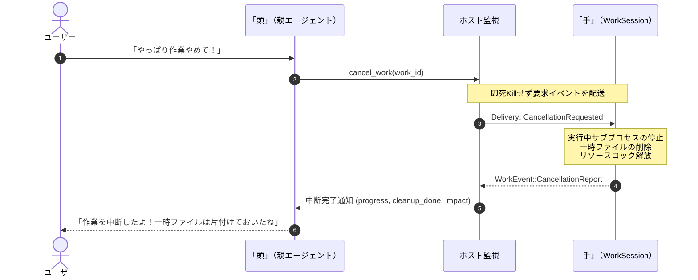

# ステップ4詳細技術設計：「手」（WorkSession）の協調プロトコル・同一キャラクター対話・進捗途絶検知

状態：Alpha採用設計（2026-11-11策定）。[全体アーキテクチャ](../architecture.md)、[作業相手API](work.md)、[技術スタック](tech-stack.md)、[実装計画](../alpha.md)を具体化する詳細技術仕様である。

---

## 1. 概念モデルと責任の境界

### A. 同一キャラクター人格の維持
「頭」（Brain / 親コンパニオン）と「手」（Hands / 作業エージェント）は内部的な技術分担であり、**ユーザーから見れば完全に同一の一人のキャラクター（人格）**である。
- **一人称プロンプト**:
  - 親（頭）のシステムプロンプトに、「作業エージェントは自分自身の『手』であり、別人物ではない。報告時は第三者表現（『〜してくれているみたい』）を固く禁じ、必ず一人称（『私が今〜しているよ』『〜まで終わったよ』）で対話すること」を厳格に指定する。
  - 子（手）のシステムプロンプトには、キャラクターの人格トーンを継承させ、報告文を簡潔かつ事実ベースでホストへ送出させる。

### B. 柔軟なタスク委託（軽量作業から重い実務まで）
- 「作業のゴール」「参照パス」「触って良い範囲」といった大掛かりな枠組みを強制しない。
- 自然言語1行の指示（「このフォルダのファイル一覧を出して」「このWebページを要約して」）から、複数ステップの開発作業まで、自然言語テキスト1本（`instruction: String`）で柔軟に委託できる。

---

## 2. データ構造・型定義（Rust）

### A. WorkSession の内部状態
```rust
use std::time::Instant;
use serde::{Deserialize, Serialize};

/// 作業セッションの状態
#[derive(Debug, Clone, PartialEq, Eq, Serialize, Deserialize)]
pub enum WorkSessionStatus {
    /// 準備中 / 開始待ち
    Idle,
    /// 実行中
    Running,
    /// ユーザーへの確認・権限要求中
    WaitingInput,
    /// 中断要求を受け、後片付け（クリーンアップ）中
    Cancelling,
    /// 正常完了
    Completed,
    /// 中断完了
    Cancelled,
    /// 失敗
    Failed,
}

/// セッションの実行追跡情報
pub struct ActiveWorkSession {
    pub session_id: String,
    pub companion_id: String,
    pub status: WorkSessionStatus,
    /// 最新の指示内容
    pub current_instruction: String,
    /// 最後に「手」からActivityやMessageを受信した時刻
    pub last_activity_at: Instant,
    /// 途絶警告プロンプトを既に親へ注入済みか
    pub stall_warned: bool,
    /// 定期報告の途絶と判定する閾値秒数（デフォルト: 45秒）
    pub stall_threshold_secs: u64,
}
```

### B. 「手」が送出するイベント（WorkEvent）
```rust
#[derive(Debug, Clone, Serialize, Deserialize)]
pub enum WorkEvent {
    /// 実行中の詳細活動ログ（例: "ファイルを解析中...", "Cargo build実行中..."）
    Activity {
        message: String,
        timestamp_ms: u64,
    },
    /// 親へ伝えるべき意味のある進捗スナップショット
    Message {
        content: String,
        timestamp_ms: u64,
    },
    /// ユーザーや親への確認・承認要求（Decision Engineで弾かれた場合等）
    Request {
        request_id: String,
        prompt: String,
        choices: Vec<String>,
    },
    /// タスクの正常完了
    Completed {
        summary: String,
        artifacts: Vec<String>,
    },
    /// 中断要求を受けたクリーンアップ完了報告
    CancellationReport {
        /// どこまで完了していたかの要約
        progress_summary: String,
        /// 一時ファイルやプロセスの後片付けが完了したか
        cleanup_done: bool,
        /// 中断に伴う留意事項や影響（例: "一部の依存パッケージのみインストールされています"）
        impact_note: Option<String>,
    },
    /// 実行失敗
    Failed {
        error_code: String,
        message: String,
    },
}
```

---

## 3. 定期報告プロトコルと進捗途絶検知システム

「手」が長時間にわたる作業を行う際、不自然な無音やフリーズを防止するため、定期報告と途絶検知（Inactivity Detection）をシステムレベルで保証する。

```text
[作業エージェント「手」]             [ホスト監視モニター]               [親エージェント「頭」]
         │                                   │                                 │
         │─── WorkEvent::Activity ──────────>│ last_activity_at更新            │
         │    (定期的: 20〜30秒ごと)         │                                 │
         │                                   │                                 │
         │   (45秒以上イベントが途絶...)      │                                 │
         │                                   │─── Prompt Injection ───────────>│
         │                                   │   [System Notification:         │
         │                                   │    作業報告が45秒間途絶。       │
         │                                   │    進捗を確認してください]      │
         │                                   │                                 │
         │                                   │                        (自発的発話)
         │                                   │                     「ちょっと様子見て
         │                                   │                      みるね！」
         │                                   │                                 │
         │<── 進捗確認メッセージ ────────────┼─────────────────────────────────│
```

### 途絶検知のルール
1. **更新タイミング**:
   「手」から `WorkEvent::Activity` または `WorkEvent::Message` が到着するたびに、ホストは `last_activity_at = Instant::now()` を更新し、`stall_warned = false` にリセットする。
2. **検知タイマー**:
   ホストのバックグラウンド監視タスク（またはTokioインターバル）が定期実行され、`now - last_activity_at > stall_threshold_secs` かつ `!stall_warned` を検知する。
3. **プロンプト文脈注入（Prompt Injection）**:
   - ツール呼び出しではなく、**通常のシステム文脈（System Notification）**として親（頭）のプロンプトへ注入する：
     ```text
     [System Notification: 作業「手」からの定期進捗報告が 45 秒間途絶えています。状況を確認するか、ユーザーへ一言伝えてください。]
     ```
   - これを受けた親（頭）は、ユーザーに「時間かかってるみたいだから確認してみるね」と自発的に声をかけたり、「手」に進捗問い合わせを送ることができる。

---

## 4. 中断（キャンセル）とクリーンアップシーケンス

ユーザーが会話やボタンで「やっぱりやめて」「キャンセルして」と指示した際、強制終了（SIGKILL）によるファイル破損やプロセス残存を防ぐため、安全なグレースフル中断シーケンスを実行する。



### シーケンス詳細
1. **中断要求の受付**:
   ユーザーの発話またはUIボタンから中断が要求されると、ホストは対象セッションのステータスを `WorkSessionStatus::Cancelling` に変更する。
2. **`CancellationRequested` イベントの配送**:
   「手」のイベント受信ループへ中断要求を配送する。「手」は現在のステップを安全に中断し、クリーンアップ処理（一時ファイルの削除、実行中プロセスの正常終了など）を開始する。
3. **`CancellationReport` の返却**:
   クリーンアップが完了すると、「手」は `WorkEvent::CancellationReport` をホストへ返す。
4. **親（頭）の一人称報告**:
   親は中断結果を受け取り、一人のキャラクターとして「作業を途中で止めたよ。作成途中の一時ファイルは綺麗に消しておいたから安心してね」と誠実にユーザーへ報告する。

---

## 5. スキル記憶（HermesAgent方式）の分離

- **「頭」への非開示**:
  - 親（頭）のシステムプロンプトには、実務スキル一覧（`Available Skills`）を**一切含めない**。親はタスクの意図とゴールを「手」へ自然言語で渡すのみ。
- **「手」の段階的読み込み（Progressive Disclosure）**:
  - 「手」は初期化時にスキルインデックス（名前と1行概要）のみを受け取る。
  - 実作業時に必要となったスキル（例: `skills/git-workflow/SKILL.md`）は、「手」の内部ツール `read_skill(skill_name: String)` を呼び出してオンデマンドで全文を取得・実行する。

---

## 6. Connect-RPC / Proto 変更仕様

`crates/ene-rpc/proto/host.proto` の `WorkService` および関連メッセージを以下のように拡張する。

```protobuf
syntax = "proto3";
package ene.host.v1;

service WorkService {
  rpc ListWorks(ListWorksRequest) returns (WorkSessionList);
  rpc GetWork(WorkRequest) returns (WorkView);
  rpc SendWork(SendWorkRequest) returns (WorkAcceptance);
  // 中断要求（グレースフルクリーンアップを伴う）
  rpc CancelWork(CancelWorkRequest) returns (WorkAcceptance);
  rpc CloseWork(CloseWorkRequest) returns (Empty);
  // 「手」からのリアルタイム進捗ストリーム
  rpc SubscribeWorkEvents(WorkRequest) returns (stream WorkEventNotification);
}

message CancelWorkRequest {
  string work_id = 1;
  string reason = 2;
}

message CancellationReportData {
  string progress_summary = 1;
  bool cleanup_done = 2;
  optional string impact_note = 3;
}

message WorkEventNotification {
  string work_id = 1;
  uint64 timestamp_ms = 2;
  oneof event {
    string activity = 3;
    string message = 4;
    CancellationReportData cancellation_report = 5;
    string completed_summary = 6;
    string failure_message = 7;
  }
}
```
