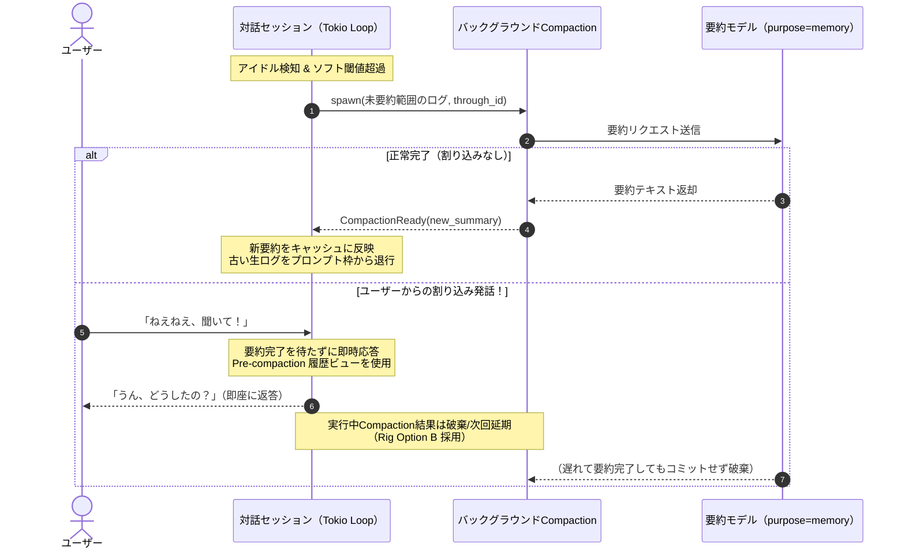

# ステップ5詳細技術設計：セッション管理・Compaction・Pre-compaction分岐継続・プロンプト順序

状態：Alpha採用設計（2026-11-11策定）。[全体アーキテクチャ](../architecture.md)、[コンテキスト圧縮](compaction.md)、[技術スタック](tech-stack.md)、[実装計画](../alpha.md)を具体化する詳細技術仕様である。

---

## 1. 目的と基本方針

長時間・無期限に対話を続けるデスクトップコンパニオンにおいて、LLMのコンテキストウィンドウ枯渇を確実に防ぎつつ、各社プロバイダーの **KVキャッシュ（Prefix Caching）** のヒット率を最大化する。

- **生ログの不変性**:
  完全な会話ログは正本として永続化され、API（`GetHistory` 等）からは改ざんなく取得できる。要約はプロンプト生成用の「揮発的・リクエスト専用ビュー」にのみ挿入される。
- **体験最優先の非同期実行**:
  要約処理の待ち時間によってユーザーへの返答を待たせない。アイドル時にバックグラウンドで要約を回し、割り込み発話には即座に応答する。

---

## 2. 発動条件と厳密なアイドル検知

Compactionの発動は、「トークン消費量」と「ユーザー無操作時間」の2つの条件によって制御する。

```text
[対話進行] ─── (トークン増加) ────────────────────────────────────────┐
                                                                       ▼
[ユーザー発話 / 操作] ─── (最終時刻を更新) ──> last_user_activity_at ──> [発動判定]
                                                                       │
┌─ (コンパニオン自身の独り言 / 見守り / 定期tick)                      │
└─> 【タイマーを更新しない（無視）】                                    │
                                                                       ▼
   ┌───────────────────────────────────────────────────────────────────┴──────────────────────────┐
   ▼ (ソフト閾値 60〜70% 超過 かつ アイドル 30〜60秒経過)                                           ▼ (ハード閾値 85〜90% 超過)
[Soft Trigger: バックグラウンドCompaction開始]                                             [Hard Trigger: 強制同期Compaction]
```

### A. 厳密なアイドル検知（Strict Inactivity Tracking）
- **タイマー更新条件**:
  - `last_user_activity_at = Instant::now()` を更新するのは、**「ユーザーからの明示的な発話・チャット入力、または画面操作」** があった場合のみである。
  - コンパニオン自身による自発的な独り言、見守り発話、スケジュール実行による定期自律発火など、理由なきキャラクター側の発話はタイマーを**リセットしない**。
- **判定ロジック**:
  - `estimated_tokens >= soft_threshold_tokens`（例: コンテキスト上限の65%）
  - かつ `now - last_user_activity_at >= idle_timeout_secs`（例: 45秒）
  - 上記の両方を満たした瞬間に、バックグラウンドCompactionジョブをキックする。

### B. 強制Compaction（Hard Trigger）
- ユーザーが休まず連続して発話を続け、アイドル状態が一度も訪れない場合に備え、**ハード閾値（例: 上限の 85〜90%）** を設定する。
- トークン数がハード閾値に到達した場合、アイドル時間を待たずに次ターンの推論前に同期的に強制Compactionを実行し、コンテキスト溢れ（Context Overflow）によるセッション破綻を確実に防止する。

---

## 3. バックグラウンドCompactionと割り込み耐性（Branching）

Compactionはアイドル時にTokioバックグラウンドタスクとして非同期に実行される。



### 割り込み時の詳細挙動（Pre-compaction継続）
1. **即時応答の保証**:
   バックグラウンドCompaction実行中にユーザーが発話した場合、Compactionの完了を待たず、Compaction開始直前の履歴ビュー（pre-compaction state）を用いて即座にモデル推論を行い、返答を返す。
2. **結果の破棄と次回延期（Rig Option B）**:
   会話履歴の木構造（DAG）において、並行して進んだステップと遅れて完成した要約を複雑に接ぎ木（リベース・マージ）することはせず、割り込みが発生した要約結果はコミットせず破棄（次回アイドル時へ延期）する。
3. **安全性**:
   ソフト閾値を低め（65%）に設定しているため、一度破棄されても直ちに上限に達することはなく、安全に次のアイドルまたは強制Compactionへ引き継がれる。

---

## 4. プロンプト構築順序（Static First, Dynamic Last）

Anthropic Claude、OpenAI、Google Gemini などの各モデルプロバイダーが提供する **KVキャッシュ（Prefix Caching）** のヒット率を最大化し、応答レイテンシとAPIコストを最小化するため、コンテキスト内の情報配置は「静的なものから動的なものへ」の順序を厳格に維持する。

| 順序 | セクション名 | 構成内容 | 更新頻度 / キャッシュ性 |
| :---: | :--- | :--- | :--- |
| **1** | **`Tools`** | 親が利用可能な最小ツール群（`talk`, `body_motion`, `instruct_hand`, `set_eye_watch`, `noop`） | **最も静的**（セッション間不変） |
| **2** | **`System Prompt`** | キャラクターのコア設定、人格・口調・対人姿勢 | **静的**（キャラクター不変） |
| **3** | **`Pinned Core Memory`** | 重要度10の中核記憶、共有プールの基本プロファイル | **ほぼ静的**（基本事実） |
| **4** | **`Compaction Summary`** | 過去の古い対話の要約テキスト | **低頻度更新**（アイドル時のみ更新） |
| **5** | **`Retrieved Memory`** | 当該ターンの話題に応じてSurrealDBから想起されたエピソード記憶 | **中頻度更新**（話題変更時） |
| **6** | **`Dynamic Context`** | 「目」の知覚要約、「手」の稼働状況、現在日時 | **高頻度更新**（毎ターン変動） |
| **7** | **`Recent History`** | 直近のユーザー発言とコンパニオン返答の生ログ | **毎ターン追記** |

### 除外事項（認知負荷とキャッシュ保護）
- 「手」（Hands / WorkSession）が保持する実務スキル一覧（`Available Skills`）は、「頭」（Brain / コンパニオンAgent）のプロンプトには**含めない**。「頭」は実務を「手」へ自然言語委託するため、スキルの詳細や一覧を持つ必要がなく、KVキャッシュの保護と認知負荷の削減を両立する。

---

## 5. データ構造・型定義（Rust）

```rust
use std::time::Instant;
use serde::{Deserialize, Serialize};

/// アイドル追跡状態
pub struct InactivityTracker {
    /// 最後にユーザーの発話または操作があった時刻
    pub last_user_activity_at: Instant,
    /// アイドルと判定する閾値秒数（デフォルト: 45秒）
    pub idle_timeout_secs: u64,
}

impl InactivityTracker {
    pub fn new(idle_timeout_secs: u64) -> Self {
        Self {
            last_user_activity_at: Instant::now(),
            idle_timeout_secs,
        }
    }

    /// ユーザーのアクションがあった場合にのみ更新
    pub fn on_user_activity(&mut self) {
        self.last_user_activity_at = Instant::now();
    }

    /// 自発的な独り言等ではタイマーを更新しない
    pub fn is_user_idle(&self) -> bool {
        self.last_user_activity_at.elapsed().as_secs() >= self.idle_timeout_secs
    }
}

/// セッションのCompaction管理状態
pub struct CompactionManager {
    /// 直近の確定済み要約
    pub current_summary: Option<CompactionSummary>,
    /// 実行中のバックグラウンド要約ジョブ
    pub active_job: Option<ActiveCompactionJob>,
    /// ソフト閾値（トークン数）
    pub soft_threshold_tokens: usize,
    /// ハード閾値（トークン数、強制Compaction）
    pub hard_threshold_tokens: usize,
}

pub struct CompactionSummary {
    /// 要約がカバーしている最新メッセージのシーケンスID
    pub through_sequence: u64,
    /// 要約本文
    pub text: String,
}

pub struct ActiveCompactionJob {
    /// 要約対象の末尾メッセージID
    pub through_sequence: u64,
    /// キャンセルフラグ（ユーザー割り込み時にtrueにし破棄）
    pub cancelled: bool,
}

/// プロンプト組み立て結果（Prefix Caching順）
pub struct AssembledPrompt {
    pub system_prompt: String,
    pub core_memory_section: Option<String>,
    pub summary_section: Option<String>,
    pub retrieved_memory_section: Option<String>,
    pub dynamic_context_section: String,
    pub recent_dialogue_entries: Vec<DialogueEntry>,
}

pub struct DialogueEntry {
    pub sequence: u64,
    pub role: DialogueRole,
    pub content: String,
}

pub enum DialogueRole {
    User,
    Assistant,
    SystemNotification,
}
```

---

## 6. 記憶自動整理（Consolidation）との同期連携

アイドル検知によるCompactionの発動は、[心と自動記憶](mind.md)のバックグラウンド自動整理（Consolidation）ジョブのキックと同期する。

1. アイドル検知時、未要約の会話範囲がCompactionへ送られると同時に、未整理の対話ログと直近の記憶引用実績（`cited_memories`）が記憶整理モデル（`purpose=memory`）へ渡される。
2. 記憶整理モデルは：
   - 新しいエピソード記憶の抽出（SurrealDBへ登録、importance 1〜10、occurred_at、emotion）。
   - 既存記憶の統合や修正、引用実績に基づく重要度スコアの再評価。
3. これにより、対話セッションの文脈圧縮と長期記憶の定着が同一のアイドルサイクルで安全に完了する。
